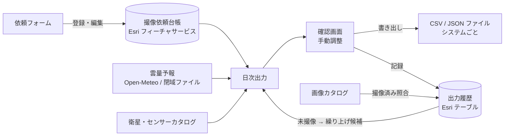
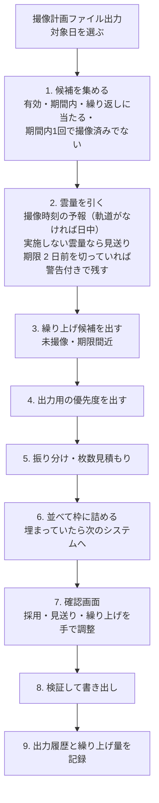

# 撮像依頼台帳と日次出力 設計書

2026-11-07 の相談内容のまとめと、その実装（「撮像依頼」ドック、`core/request/`）。役割の分け方（§13）だけは今後の検討で、まだ実装していない。

## 1. 目的

今の撮像計画は「パスから撮像の可否を見る」ための道具。実際の運用では、各衛星システムに「いつからいつまで・どこを・どのセンサーで撮るか」を入力している。そこで次の 2 つを用意する。

- **撮像依頼台帳**: 定点撮像・臨時撮像の依頼を登録しておく場所
- **日次作業**: 毎日、台帳から依頼を集め、各システムのフォーマットに合わせた CSV / JSON ファイルを作る

できたファイルは、人が各システムに入力する（API での直接送信は将来の課題）。

## 2. 全体構成



モジュールの置き場所

| 置き場所 | 中身 |
|---|---|
| `core/request/model.py` | 依頼のデータ型、対象日に有効かどうか（期間・繰り返し・達成条件） |
| `core/request/store.py` | 台帳・出力履歴の Esri 読み書き、属性との読み書き |
| `core/request/systems.py` | 出力先のシステムの設定（`requestExports`: 持つ衛星・1 日の上限・ファイルの書き方） |
| `core/request/route.py` | 条件とシステムの突き合わせ、枚数の見積もり |
| `core/request/weather.py` | 撮像時刻（軌道がなければ日中）の雲量、優先度への反映（`plan/weather.py` を利用） |
| `core/request/daily.py` / `core/request/workflow.py` | 日次の計算（その日の依頼集め・並べ替え・枠詰め）と、出力履歴・繰り上げへの書き戻し |
| `core/request/follow.py` | 出力した依頼の追跡（画像カタログと照らした撮像済み・未撮像） |
| `core/request/export.py` | CSV / JSON の組み立て、値の変換 |
| `core/request/schema.py` | JSON Schema の検証（よく使う範囲を自前で実装） |
| `core/request/view.py` | 「撮像計画ファイル出力」の一覧の絞り込み（システム・衛星シリーズ・結果・文字、§18） |
| `ui/request_dock.py` | 「撮像依頼」ドック（一覧・絞り込み・登録フォーム） |
| `ui/plan_file_dock.py` | 「撮像計画ファイル出力」ドック（日次の計算・確認・書き出し。依頼の登録とは別の人が使うため、撮像依頼ドックから独立） |
| `core/request/simulate.py` / `ui/limit_sim_dialog.py` | 上限シミュレーション（§17） |
| `core/request/result_file.py` / `core/request/adoption.py` | システムの結果ファイルの読み方（列・JSON Schema の `x-target`）・依頼との突き合わせ、採否の手入力・要求外（§20） |
| `ui/schedule_dock.py` | 「撮像予定」ドック（日ごとの計画: カレンダー・一覧・地図・採否・要求外、§20） |
| `core/request/quota.py` / `ui/quota_dialog.py` | 年間撮像上限（消費・見込み・残り、日次の計算での残りの確認、数えない撮像、§27） |

## 3. 設定（config.json）

```jsonc
{
  "requestStores": [{
    "label": "撮像依頼",
    "url": "https://…/FeatureServer/0",      // 台帳（ポリゴン）
    "history": "https://…/FeatureServer/1",  // 出力履歴（ポリゴン、テーブルでも可）。日ごとの撮像予定も（§20）
    "catalog": "画像カタログ",                 // 撮像済み照合に使うカタログ
    "fields": { "priority": "PRIORITY" }     // 属性名を変えるときだけ
  }],
  "requestExports": [{
    "system": "SYS-A",
    "label": "A システム",
    "series": ["XXX"],                       // このシステムで撮れる衛星シリーズ
    "satellites": [],                        // 個別の衛星（任意）
    "kind": "光学",                           // 光学 / SAR / 両方
    "order": 1,                              // 複数のシステムに合うときに試す順番
    "limit": { "count": 20, "scenes": 50 },  // 1 日あたりの上限（片方だけでも可）
    "quota": { "定点": 12, "臨時": 8 },       // 区分ごとの枠（任意）
    "sceneKm": [20, 20],                     // 枚数を見積もるシーンの大きさ（任意）
    "format": "csv",                         // csv / json
    "folder": "D:/requests/SYS-A",
    "fileName": "{system}_{date:%Y%m%d}.csv",
    "maxPerFile": 500,                       // 1 ファイルの依頼件数の上限（任意）。超えた日は分けて書き出す（§22）
    "encoding": "cp932",                     // cp932 / utf-8 / utf-8-sig
    "timeZone": "Asia/Tokyo",
    "columns": [ /* CSV のとき。§8 */ ],
    "schema": "schemas/sys-b.schema.json",   // JSON のとき。§8
    "priority": { /* 優先度の変換。§5.4 */ },
    "values": { "lookSide": { "右": "R", "左": "L" } },  // 値の読み替え
    "resultFile": { "columns": [{ "key": "REQ_ID", "target": "id" }, { "key": "STATUS", "target": "result" }] }  // システムから返る採否のファイルの読み方（任意。§20）
  }]
}
```

## 4. 依頼台帳

Esri のポリゴンレイヤー（1 依頼 = 1 フィーチャ）。点で指定するときは、フォームで中心と大きさを入れて正方形を作り、`SHAPE_KIND` に「点」と残す。

| 役割 | 既定の属性名 | 中身 |
|---|---|---|
| id | `REQ_ID` | 依頼の ID（UUID） |
| name | `REQ_NAME` | 名称 |
| managementNo | `MANAGEMENT_NO` | 管理番号（文字列、任意。出力項目 `managementNo`） |
| identificationNo | `IDENTIFICATION_NO` | 識別番号（文字列、任意。出力項目 `identificationNo`。管理番号とは別の項目） |
| category | `CATEGORY` | 定点 / 臨時 |
| achieve | `ACHIEVE` | 毎回 / 期間内1回 |
| start / end | `START_AT` / `END_AT` | 期間 |
| repeat | `REPEAT` | 定点の繰り返し: `毎日` / `曜日:月水金` / `間隔:3`（3 日ごと） |
| status | `STATUS` | 有効 / 停止 / 完了 |
| priority | `PRIORITY` | 1〜1000（1 ほど高い） |
| boost | `BOOST` | 繰り上げ量（100 単位。§9） |
| kind | `KIND` | 光学 / SAR / 任意 |
| series | `SERIES` | 衛星シリーズ（カンマ区切り、空なら問わない）。フォームでは撮像計画と同じ階層選択でシリーズ全体をチェック |
| satellites | `SATELLITES` | 衛星を個別に指定（任意） |
| modes | `SENSOR_MODES` | センサー・モード（カタログから選択） |
| offNadir | `OFF_NADIR_MIN` / `OFF_NADIR_MAX` | オフナディア角の範囲 |
| incidence | `INCIDENCE_MIN` / `INCIDENCE_MAX` | 入射角の範囲 |
| lookSide | `LOOK_SIDE` | 右 / 左 / 任意 |
| orbitDir | `ORBIT_DIR` | 昇交 / 降交 / 任意 |
| resolution | `RESOLUTION_MAX` | これより細かい分解能（m） |
| timeOfDay | `TIME_OF_DAY` | 昼 / 夜 / 任意（主に SAR） |
| cloudMax | `CLOUD_NO_GO` | この雲量（%）以上なら実施しない（光学） |
| timesMin / timesMax / timesGap | `TIMES_MIN` / `TIMES_MAX` / `TIMES_GAP` | 1 日の回数: n 回以上・m 回以下、回と回の間隔（時間）。空なら 1 回・下限と同じ・1 時間（§25） |
| systems | `SYSTEMS` | 優先するシステムの順番（任意） |
| shapeKind | `SHAPE_KIND` | 点 / 範囲 |
| requester / note | `REQUESTER` / `NOTE` | 依頼者・メモ |
| created / updated | `CREATED_AT` / `UPDATED_AT` | 登録・更新日時 |

台帳・出力履歴とも、`CREATED_DATE`・`CREATED_USER`・`UPDATED_DATE`・`UPDATED_USER` の属性があれば、追加・更新のたびに日時と書き込んだ人（環境変数 `USERNAME`）も入る（設定ファイルの `editTracking`、README の「作成者・更新者の記録」）。

条件の項目は、空なら「問わない」として扱う。

## 5. 優先度

### 5.1 台帳の値
1〜1000 の整数で持ち、1 ほど優先度が高い。

### 5.2 入力
フォームでは 5 段階から選び、選んだ段階の代表値を保存する。「詳細」ボタンを押すと 1〜1000 を直接入れられる（全員が使える）。

| 段階 | 帯 | 代表値 |
|---|---|---|
| 最優先 | 1〜200 | 100 |
| 高 | 201〜400 | 300 |
| 中 | 401〜600 | 500 |
| 低 | 601〜800 | 700 |
| 最低 | 801〜1000 | 900 |

一覧では「高（342）」のように段階と数値を並べて表示する。

### 5.3 出力用の優先度
1. `p = PRIORITY − BOOST`（繰り上げ。§9）
2. 光学で予報が取れたときだけ、1 の位を雲量の段階で上書きする: `p = floor(p / 10) × 10 + 雲量の段階`
3. 1〜1000 に収める

SAR の依頼と予報が取れなかった依頼は、2 を飛ばす。

### 5.4 システムごとの変換（`priority`）
```jsonc
// 対応表: 数値の帯で引く
{ "table": [ { "max": 200, "value": "High" }, { "max": 600, "value": "Middle" }, { "max": 1000, "value": "Low" } ] }
// 線形: 1〜1000 を出力側の範囲に割り当てる
{ "linear": { "min": 0, "max": 99, "higherIsLarger": true }, "format": "%02d" }
```
どちらも最後に `format`（0 埋めの桁数、小数の桁数）をかけられる。

## 6. 気象（光学のみ）

- **予報の取得元**: 今の `cloudForecast`（Open-Meteo 形式の API）。閉域網では、別途検討中の「日次の雲量予報 GeoTIFF をフォルダから読む」方式に差し替える。0.25° の格子と時刻の補間は今の `plan/weather.py` を使う。
- **見る時刻**（2026-11-11 変更、tsudo「全体雲量はいいや。撮像時刻の予報に変えてみようか。もちろん、3時間間隔とかだから、バランス取ってね」）:
  - 軌道で詰める衛星（TLE が読め、システムが `orbit: false` でない。§24）は、その日の **パスごとに撮像時刻の予報** を見る。予報は 1〜3 時間おきなので、撮像時刻の前後の予報を時刻の近さで按分する（13:00 が 20%、16:00 が 80% なら 14:00 は 40%）。
  - 依頼の雲量（並べ替え・優先度の 1 の位・見送りの判断）は、その日いちばん雲の少ないパスの値。どのパスも実施しない雲量以上なら見送り（理由「雲量 63%（撮像時刻の予報でどのパスも 50% 以上）」）。
  - パスを選ぶとき、実施しない雲量以上のパスは使わない（期限間近と手動の採用は使う）。雲の少ないパスから試す。比べるのは 10% の段階（優先度の 1 の位と同じ）だけで、同じ段階なら今までどおり（まとめられる撮像、オフナディア角の小さいパス）。数分違いのパスの数 % の差は 3 時間おきの予報では意味がないため。衛星を指定していない依頼は、衛星も雲の少ないパスのある衛星から試す（同じ段階なら分解能の細かい衛星から）。
  - 書き出す雲量（`cloudForecast`・`weatherFlag`・出力履歴の `CLOUD`）は、採用したパスの撮像時刻の値。いちばん雲の少ないパスに入れなかったとき（空きなしなど）は、優先度の 1 の位と食い違うことがある（計算画面の雲量のツールチップに両方を出す）。
  - まとめ（§24）では、まとめに入る依頼も自分の範囲の撮像時刻の雲量で判断する。自分の範囲がその時刻に実施しない雲量以上なら、その撮像にはまとめない。
  - 軌道で詰めない衛星（TLE がない、`orbit: false`）だけの依頼は今までどおり日中の平均。範囲の地方時（経度 ÷ 15 で求める地方太陽時）の 9〜15 時。
- **見る場所**: ポリゴンの中の格子点すべての平均（多ければ 25 か所に間引く）。点の依頼は 1 か所。撮像時刻の予報も同じ。
- **雲量の段階**: `min(9, floor(雲量% / 10))`。0〜9% → 0、…、90% 以上 → 9。
- **実施しない雲量**: 雲量が `CLOUD_NO_GO` 以上なら、その日は出さない（見送り、理由「雲量」）。ただし「期間内1回」の依頼で期限まで 2 日を切っていれば、警告を付けて出す（軌道で詰めるときは、いちばん雲の少ないパスで）。
- **予報が取れないとき**: 優先度は台帳の値のまま出し、警告「予報なし」を付ける。
- **出力項目**: `cloudForecast`（%）と `weatherFlag`（OK / 雲多 / 予報なし）。

## 7. 日次ワークフロー



1. **候補を集める**: `STATUS = 有効`、対象日が期間内、定点なら繰り返しの決まりに当たる日。「期間内1回」の依頼は、すでに撮像済みなら外す。
2. **雲量**: §6。
3. **繰り上げ候補**: §9。確認画面ではチェックが入った状態で並べ、確定するまでは適用しない（並べ替えにはチェックどおり反映して見せる）。
4. **出力用の優先度**: §5.3。
5. **振り分け**: 依頼の条件（種別、シリーズ、衛星、モード、角度、観測方向、軌道方向、分解能、時間帯）と、システムの `series` / `satellites` / `kind` が重なるシステムを候補にする。試す順番は依頼の `SYSTEMS`、無ければ設定の `order`。どのシステムにも合わなければ見送り（理由「該当システムなし」）。
   **枚数の見積もり**: 点は 1 枚。範囲は、今の撮像計画の範囲分割を使ってシーン数を出す。シーンの大きさは、依頼でモードを特定していればそのモードの幅と長さ、そうでなければシステムの `sceneKm`。
6. **並べ替えと枠詰め**: 出力用の優先度が小さい順、同じなら期限が近い順、次に登録が古い順。上から順に、システムの `limit`（件数・枚数）と区分ごとの `quota` を満たし、かつ衛星（モード）の `maxPerDay` に空きがある間だけ採用する。
   - **衛星を指定している依頼**: 指定した衛星（複数なら書いた順）に先にはめる。空きが無ければ、そのシステムでは見送り。
   - **衛星を指定していない依頼**: 条件に合い、空きのある衛星のうち、分解能が細かいものからはめる。同じ分解能なら空きが多いほう。光学の依頼は、その前に雲の少ないパスのある衛星から（10% の段階で比べる。§6）。
   - 割り当てた衛星・モードは出力項目 `satellite` / `mode` として出せる。
   - システムで満たせなければ次のシステムを試し、どこにも入らなければ見送り（理由「枠超過」）。
   - **軌道のパス**（2026-11-11 追加、§24）: 衛星カタログの TLE が読める衛星は、その日のパスで撮れる時刻を出し、1 回の撮像（幅 × 連続シーン）に近くの依頼をまとめ、同じ衛星の撮像間隔 `minInterval` と 1 日の回数 `maxPerDay` を撮像の単位で守る。軌道方向・入射角・観測方向・時間帯はここで効く。理由は「撮像機会なし」「衛星の空きなし（撮像間隔・1 日の回数）」も出る。TLE のない衛星と `orbit: false` のシステムは上のとおり件数で詰める。
7. **確認画面**: システムごとに採用と見送りの一覧を出す。採用・見送りの切り替え、順番の入れ替え、繰り上げの取り消しができる。手で変えたら枠の残りを計算し直して表示する。
8. **書き出し**: §8 の形式で、システムごとに 1 ファイル。JSON はスキーマで検証し、合わなければそのシステムは書き出さずにエラーを表示する。同名のファイルがあれば確認する。
9. **記録**: 出力履歴テーブルに、採用・見送りの全件を書く（採用はシステムの採否 `不明` で、範囲も。§20）。確定した繰り上げを台帳の `BOOST` に書く。
   - ファイルを書けなかったシステム（スキーマ不一致・書き込みエラー）の依頼は、採用ではなく「見送り（書き出し失敗: 理由）」として記録する。照合も完了もされず、繰り上げと未撮像の確認済みは翌日に残す（#68）。
   - 同じ対象日の出力履歴（まだ判定していない行）が既にあれば、「置き換えて書き出し」（前回の行を消して入れ直す、既定。取り込み済みの採否は引き継ぐか残す。§20）か「追加して書き出し」かを確認する。保存の一部が失敗したら件数（n/m 件）と理由を出すので、もう一度「書き出し」で置き換えてやり直せる（#71）。

毎回、その日に有効な依頼を全件出す（差分は出さない）。見送った「期間内1回」の依頼は台帳に残るので、翌日の候補にまた入る。

## 8. 出力形式

### 8.1 CSV（キーの指定）
```jsonc
"columns": [
  { "key": "REQUEST_ID", "source": "id" },
  { "key": "管理番号",   "source": "managementNo", "default": "000" },   // 空なら 000
  { "key": "識別番号",   "source": "identificationNo", "format": "%08d" }, // 123 → 00000123
  { "key": "START",      "source": "start", "format": "%Y-%m-%dT%H:%M:%S" },
  { "key": "AOI",        "source": "geometry", "geometry": "wkt" },
  { "key": "CENTER",     "source": "geometry", "geometry": "centerGeojson", "digits": 5 },
  { "key": "SATS",       "source": "seriesSatellites", "default": "ANY" }, // OPT-X1,OPT-X2 / 空なら ANY
  { "key": "PRIORITY",   "source": "priority" },
  { "key": "SIDE",       "source": "lookSide", "map": { "右": "R", "左": "L", "任意": "" } },
  { "key": "FIXED",      "value": "001" }          // 固定値（書いたとおりの文字）
]
```
- 列の順番は `columns` の並び順。ヘッダー行の有無も設定できる。
- `allowed` に値の一覧を書けば、それ以外の値が出たときに警告する。
- `default`: 値が空（なし・空文字・空の配列）のときに書く文字。
- 配列の項目（§8.3 の「配列」）は、カンマ区切りの 1 つのセルになる（`OPT-X1,OPT-X2`）。固定値に配列を書いた場合も同じ。

### 8.2 JSON（JSON Schema で指定）
システムが求める JSON Schema に `x-source` などの注記を足したファイルを置く。

```jsonc
{
  "type": "object",
  "required": ["date", "requests"],
  "properties": {
    "date":     { "type": "string", "format": "date", "x-source": "runDate" },
    "requests": {
      "type": "array", "x-source": "requests",
      "items": {
        "type": "object",
        "required": ["id", "aoi", "priority", "satellites", "cloud"],
        "properties": {
          "id":         { "type": "string",  "x-source": "id" },
          "controlNo":  { "type": "string",  "x-source": "managementNo" },
          "identNo":    { "type": "string",  "x-source": "identificationNo" },
          "aoi":        { "type": "object",  "x-source": "geometry", "x-geometry": "geojson" },
          "center":     { "type": "object",  "x-source": "geometry", "x-geometry": "centerGeojson" },
          "priority":   { "type": "string",  "enum": ["High", "Middle", "Low"], "x-source": "priority" },
          "from":       { "type": "string",  "format": "date-time", "x-source": "start" },
          // シリーズで依頼したときのシリーズ配下の衛星。シリーズ指定のない依頼は [""]
          "satellites": { "type": "array", "items": { "type": "string" }, "minItems": 1,
                          "x-source": "seriesSatellites", "default": [""] },
          // 必須だが雲量の指定がない依頼もある → 既定値 100
          "cloud":      { "type": "integer", "x-source": "cloudMax", "default": 100 },
          "options":    { "type": "array", "items": { "type": "string" }, "const": ["On"] },  // 固定値
          "tags":       { "type": "array", "items": { "type": "string" }, "default": [] }     // いつも []
        }
      }
    }
  }
}
```
- `x-source`: 入れる項目。`requests` の付いた配列が依頼の一覧になり、`items` の中の `x-source` は依頼 1 件ごとの項目を指す。
- `x-format` / `x-map` / `x-geometry` / `x-digits`: CSV の `format` / `map` / `geometry` / `digits` と同じ働き。
- 検証で扱う範囲: `type`、`required`、`enum`、`const`、`pattern`、`minimum` / `maximum`、`minLength` / `maxLength`、`minItems` / `maxItems`、`format`（date / date-time）、`items`、`properties`、`additionalProperties`。外部ライブラリの jsonschema を使う場合は、方針どおり Windows 版の zip にだけ同梱する。

#### 固定値（`const`）と既定値（`default`）

| 書き方 | 出る値 |
|---|---|
| `"const": ["On"]` | いつも `["On"]`（`x-source` 不要） |
| `"default": []`（`x-source` なし） | いつも `[]` |
| `"x-source": "…", "default": [""]` | 値があればその値、空（なし・空文字・空の配列）なら `[""]` |
| `"x-source": "…", "default": 100` | 値があればその値、空なら `100`（必須の項目が空で検証に通らないときに使う） |
| `"default": …, "x-default": false` | `default` は書かない（システム側の既定に任せる。スキーマにもとからある `default` を出したくないとき） |

- `const` と `default` の値は、書いたとおり（配列・オブジェクト・文字・数）に出る。`x-map` や `x-format` はかからない。
- `default` がないとき: 値がない（none）項目は、必須（`required`）でなく `null` を許さない型なら出さない（必須の項目と `null` を許す型は `null`）。空文字・空の配列はそのまま出る（`""`・`[]`）。必須の項目が空だと、検証で型の違い（`null` は integer 以外 など）や `minItems` で止まる。
- 設定ファイル作成ツールでは、プロパティの行の「既定値」に書く。配列は JSON で（`[]`・`[""]`・`["On"]`）。型が `string` の固定値・既定値は書いたとおりの文字（`001` も `001` のまま）。

#### 配列の項目
`series`・`satellites`・`modes`・`seriesSatellites`・`seriesSatelliteIds` は配列の値。

- プロパティの `type` が `array` なら JSON の配列（`["OPT-X1", "OPT-X2"]`）。`items` の `type` が `integer` なら要素を数にする。
- `type` が `string`（や型なし）なら、カンマ区切りの文字（`"OPT-X1,OPT-X2"`）。これまでの設定はこのまま同じ出力になる。
- `x-map` とシステムの `values` は要素ごとにかかる。

### 8.3 使える項目（`source` / `x-source`）

| 項目 | 中身 |
|---|---|
| `id` / `name` | 依頼 ID / 名称 |
| `managementNo` / `identificationNo` | 管理番号 / 識別番号（台帳の `MANAGEMENT_NO` / `IDENTIFICATION_NO`。別々の項目。依頼フォームで入力、文字のまま出る） |
| `category` / `achieve` / `repeat` | 区分 / 達成条件 / 繰り返し |
| `start` / `end` | その日の撮像の窓（§16） |
| `periodStart` / `periodEnd` | 依頼そのものの期間 |
| `priority` / `priorityRaw` / `priorityBase` / `boost` | §5.4 で変換した値 / 出力用の優先度 1〜1000 / 台帳の値 / 繰り上げ量 |
| `kind` | 種別 |
| `series` / `satellites` / `modes` | 依頼で指定した衛星シリーズ / 衛星 / センサーモード（配列） |
| `seriesSatellites` | 衛星シリーズで依頼したとき、そのシリーズ配下の個々の衛星（配列）。出力するシステムの衛星のうち、依頼の条件（種別・分解能・角度など）で撮れるもの。衛星カタログの順、モード違いは 1 つにまとめる。シリーズ指定のない依頼は空の配列 |
| `seriesSatelliteIds` | 同じ衛星の ID（衛星カタログの `id`、配列） |
| `satellite` / `satelliteId` / `mode` / `sensor` | 割り当てた衛星 / その ID / モード / センサー |
| `offNadirMin` / `offNadirMax` / `incidenceMin` / `incidenceMax` | 角度の範囲 |
| `lookSide` / `orbitDir` / `resolution` / `timeOfDay` | 観測方向 / 軌道方向 / 分解能 / 時間帯 |
| `cloudMax` / `cloudForecast` / `weatherFlag` | 実施しない雲量 / 雲量予報（%） / 気象の注意 |
| `scenes` | シーン数（軌道のパスで詰めたときは撮像の連続シーン数、§24） |
| `passTime` / `passOffNadir` / `passIncidence` / `passDirection` / `passLookSide` | 撮像の時刻・オフナディア角・入射角・軌道方向（昇交・降交）・観測方向（右・左）（§24。軌道なしで詰めた依頼は空） |
| `mergedIds` / `mergedNames` / `mergedCount` | 1 回の撮像にまとめた依頼の ID・名称（配列）・件数（§24） |
| `occurrence` / `occurrenceId` / `timesMin` / `timesMax` | その日の何回目か（1, 2 …）・回つきの ID（`R-0001-2`。1 日 1 回の依頼は ID のまま）・1 日の回数の下限と上限（§25） |
| `linkId` | 外部連携ID: 出力の行の短い ID（既定 12 文字、`linkIdLength`・`linkIdChars`）。出力履歴の `LINK_ID` と同じ値で、結果ファイルの `linkId` でこの行と照合する（§29） |
| `geometry` | 範囲（§8.4 の書き方。まとめた撮像の行はまとめた依頼を囲むパスに平行な四角、§24.3） |
| `centerLat` / `centerLon` / `bboxWest` / `bboxSouth` / `bboxEast` / `bboxNorth` | 中心・外接矩形の数値 |
| `requester` / `note` / `warnings` | 依頼者 / メモ / 警告 |
| `group` | 依頼グループ（§23。空はグループなし） |
| `system` / `runDate` / `day` / `count` | システム名 / 出力日時 / 対象日 / そのファイルの依頼件数（ファイル全体の項目。`requests` の外でも使える） |
| `part` / `parts` | 何番目のファイルか（1 から） / その日のそのシステムのファイルの数（`maxPerFile` で分けたとき。分けなければ 1 / 1。ファイル全体の項目） |

### 8.4 座標の書き方（`geometry` / `x-geometry`）

| 指定 | 例（小数 3 桁） |
|---|---|
| `wkt` | `POLYGON ((139.800 35.450, 139.900 35.450, …))` |
| `geojson` | `{"type":"Polygon","coordinates":[[[139.8,35.45],…]]}`（JSON ではオブジェクト） |
| `centerGeojson` | `{"type":"Point","coordinates":[139.85,35.5]}`（オーダーポリゴンの中央。JSON ではオブジェクト） |
| `bbox` | `139.8,35.45,139.9,35.55`（西,南,東,北） |
| `center` | `35.5,139.85`（緯度,経度） |
| `centerRadius` | `35.5,139.85,7.148`（緯度,経度,外接矩形の対角の半分 km） |
| `vertices` | `35.45,139.8,35.45,139.9,…`（緯度,経度 を頂点の順に） |

- 中央は範囲の外接矩形の真ん中（`center`・`centerLat` / `centerLon` と同じ点）。
- 小数の桁数は `digits` / `x-digits`（0〜12、既定はシステムの `digits`、無ければ 6）。

### 8.5 日時
- **対象日**は JST で区切る（00:00〜24:00 JST）。
- **出力のタイムゾーン**はシステムごとに `timeZone` で指定する（`"UTC"` / `"Asia/Tokyo"` / `"+09:00"` など。既存の timeZone 設定と同じ書き方）。
- **書式**は既定が ISO 8601。システム全体の `dateFormat`、または列・項目ごとの `format` / `x-format` で変えられる。

| 指定 | 例（2026-11-08 09:00 JST、出力 UTC） |
|---|---|
| `iso`（既定） | `2026-11-08T00:00:00Z`（JST 出力なら `2026-11-08T09:00:00+09:00`） |
| `iso-date` | `2026-11-08` |
| `unix` | `1794096000`（秒） |
| `unixms` | `1794096000000`（ミリ秒） |
| strftime 形式 | `%Y%m%d` → `20261108`、`%Y/%m/%d %H:%M` → `2026/11/08 00:00` |

unix / unixms はタイムゾーンに関係なく同じ値になる。

### 8.6 数値の書式（`format` / `x-format` / 優先度の `format`）

日時の項目（`start`・`end`・`periodStart`・`periodEnd`・`runDate`）以外では、`format`（CSV の列）・`x-format`（JSON のプロパティ）・優先度の変換（§5.4）の `format` は、**printf 形式**（C や Python の `%` と同じ書き方）で数を書く。

#### 書き方
`%` `[フラグ]` `[幅]` `[.精度]` `変換` の 1 つと、その前後の文字。

| 部分 | 指定 | 意味 |
|---|---|---|
| 変換 | `d`（`i`・`u` も同じ） | 整数（10 進） |
| | `f`（`F`） | 小数（既定は小数 6 桁） |
| | `e` / `E` | 指数表記（`1.23e+03`） |
| | `x` / `X` / `o` | 16 進（小文字 / 大文字）/ 8 進 |
| | `s` | 文字のまま（前後に文字を付けるとき） |
| フラグ | `0` | 幅に満たない分を 0 で埋める |
| | `-` | 左寄せ（右側を空白で埋める） |
| | `+` | 正の数にも `+` を付ける |
| | ` `（空白） | 正の数の前に空白（負の数の `-` と桁をそろえる） |
| | `#` | 16 進・8 進に `0x`・`0o` を付ける |
| 幅 | 数字 | 全体の最小の文字数（符号・小数点も数える） |
| 精度 | `.` + 数字 | `f`・`e` は小数の桁数、`d` は最小の桁数（足りない分を 0 で）、`s` は最大の文字数 |
| `%%` | | `%` の文字そのもの |

#### 例

| 書式 | 値 | 出力 | 使いどころ |
|---|---|---|---|
| `%d` | `42.6` | `43` | 整数に（四捨五入） |
| `%03d` | `7` | `007` | 0 埋め 3 桁（優先度・番号） |
| `%08d` | `"123"`（文字の番号） | `00000123` | 識別番号の桁をそろえる |
| `%.3d` | `5` | `005` | `%03d` と同じ（精度で桁数） |
| `%5d` | `42` | `   42` | 右寄せ 5 文字 |
| `%-5d` | `42` | `42   ` | 左寄せ 5 文字 |
| `%+d` | `5` | `+5` | 符号を必ず付ける |
| `%.1f` | `35.4567` | `35.5` | 小数 1 桁 |
| `%.0f` | `2.5` | `2` | 小数なし（ちょうど半分は偶数側、下の注意） |
| `%06.2f` | `-3.14159` | `-03.14` | 符号・小数点を含めて 6 文字、0 埋め |
| `%.2e` | `1234.5` | `1.23e+03` | 指数表記 |
| `%04X` | `255` | `00FF` | 16 進 4 桁（大文字） |
| `%#x` | `255` | `0xff` | 16 進に 0x を付ける |
| `P%02d` | `3` | `P03` | 前に文字を付ける |
| `%d%%` | `42` | `42%` | 後ろに % を付ける |
| `ID-%s` | `"abc"` | `ID-abc` | 文字の前に付ける |

#### 決まりごと
- **整数の変換（`d`・`i`・`u`・`x`・`X`・`o`）は四捨五入してから**書く（`12.5` → `13`、`12.4` → `12`、`-12.5` → `-12`。0.5 は大きい側に）。
- **小数の変換（`f`・`e`）の丸め**は、コンピューター内部の 2 進数の値で決まる。ちょうど半分のときは偶数側（`%.1f` で `0.25` → `0.2`、`%.0f` で `2.5` → `2`、`3.5` → `4`）。`0.35` は内部では 0.34999… なので `%.1f` で `0.3`、`1.005` は `%.2f` で `1.00`。四捨五入をはっきりさせたいときは、整数の変換（`%d`）を使うか、桁を 1 つ多く出す。
- **数に見える文字**（`"123"`・`"007"`・`"12.5"`。管理番号・識別番号など）は、数の変換では数として書く（`%05d` で `"123"` → `00123`）。数に見えない文字（`"K-12"`）は、数の変換ではそのまま出る。
- **書式が合わないとき**（変換が 0 個か 2 個以上、数でない値に数の変換）は、値をそのまま出す（エラーにはしない）。
- **空の値**（なし・空文字）には書式をかけない。`default` があればそれを書く（`default` には書式はかからない）。
- **配列**には要素ごとにかける（`seriesSatelliteIds` に `%05d` → `["00042", "00043"]`）。
- **書く順番**: システムの `values` → 列の `map`（`x-map`）→ 書式 → JSON ではスキーマの型に合わせる。優先度（`priority`）は §5.4 の変換と `format` のあとに、さらに列の書式をかけられる。
- **JSON の型との関係**: 書式の結果は文字。プロパティの `type` が `integer` / `number` だと数に戻る（`%03d` → `"007"` → `7`）。0 埋めや `+` を残したいときは `"type": "string"` にする。

| `x-format` | `type` | 値 `7` の出力 |
|---|---|---|
| `%03d` | `string` | `"007"` |
| `%03d` | `integer` | `7` |
| `%.1f` | `string` | `"7.0"` |
| `%.1f` | `number` | `7.0`（JSON では `7.0`） |

- **書式のない数**は、CSV ではそのまま（`35.5`・`1e-05` のように短い表記）、JSON では数として出る。座標は `digits` / `x-digits` で丸める（`wkt` だけは桁数をそろえて `35.450` のように書く）。
- **優先度の `format`**: §5.4 の変換のあとにかかる（`{ "linear": { "min": 0, "max": 99, "higherIsLarger": true }, "format": "%02d" }` → `07`）。対応表（`table`）の値が文字（`High`）のときは、`%s` を含む書式だけがかかる（`P-%s` → `P-High`）。

## 9. 撮像済みの判定と繰り上げ

- **出力履歴**（Esri テーブル）: `RUN_ID`, `RUN_DATE`, `REQ_ID`, `SYSTEM`, `PRIORITY_OUT`, `CLOUD`, `SCENES`, `RESULT`（採用 / 見送り）, `REASON`, `OUTPUT_FILE`, `CAPTURED`（未判定 / 撮像済み / 未撮像）, `IMAGE_ID`
- **撮像済みの判定**: 採用した依頼について、画像カタログで「範囲と重なり、出力日以降に撮られた、条件に合う画像」を探す。見つかれば撮像済み、`miss_after_days` を過ぎても無ければ未撮像。
- **「期間内1回」の依頼**: 撮像済みになったら台帳の `STATUS` を「完了」にする。
- **繰り上げ候補**: 未撮像になった依頼と、期限まで 2 日を切った「期間内1回」の依頼。
- **繰り上げの幅**: 1 回につき `BOOST` を 100 増やす。`PRIORITY − BOOST` が最優先の帯（200 以下）に入ったら、それ以上は増やさない。例: 742 → 642 → … → 142 で止まる。下 2 桁が残るので、帯の中での順番は崩れない。
- **撮像済みになったら**: `BOOST` を 0 に戻す。
- **衛星の一致**（2026-11-07 追記）: 衛星かシリーズを指定した依頼は、渡した衛星・指定の衛星・シリーズ（衛星名の対応表 `satelliteAliases` の別名を含む）の画像だけを撮像済みとする。ほかの衛星の画像が範囲にあっても数えない。指定のない依頼はどの衛星の画像でもよく、渡した衛星の画像を優先して `IMAGE_ID` にする。
- **持ち越し**（2026-11-07 追記）: 未撮像の依頼は次回の計算の候補に入れる。曜日・間隔の定点でその日が繰り返しの日でなくても、状態が有効で期間内なら候補にし、「未撮像の持ち越し」と警告を付ける。雲量の予報も持ち越した日のものを取り、実施しない雲量以上なら見送る（上限シミュレーションも同じ）。書き出すと `BOOST_DONE` が 1 になり、持ち越しも繰り上げもそれきり。
- **計画と実績の照合**（2026-11-07 追記）: 「撮像計画ファイル出力」ドックの「照合…」で開く。対象日の範囲の採用の依頼を一覧にし（対象日・システム・衛星・依頼・撮像・画像ID・この先）、システムごとに撮像済み・未撮像・未判定と撮像率（判定済みのうち撮像済みの割合）を出す。「照合」で未判定の依頼をカタログと照合して保存する。「撮像済みにする」「未撮像にする」で手で直せる。撮像済みにすると台帳の `BOOST` は 0・期間内1回は完了に、完了の依頼を未撮像に戻すと有効に戻り、`BOOST_DONE` も 0 に戻るので次回また繰り上げの候補になる。

## 10. 警告と見送りの理由

| 種類 | 内容 |
|---|---|
| 見送り | 雲量（実施しない雲量以上。軌道で詰めるときはどのパスも）、雲量（空いている撮像機会は撮像時刻の予報で実施しない雲量以上）、枠超過、該当システムなし、撮像機会なし・衛星の空きなし（撮像間隔・1 日の回数）（§24）、手動で見送り |
| 警告 | 予報なし、期限間近で雲量超過のまま出力、撮像時刻の雲量が実施しない雲量以上のまま出力（期限間近・手動で採用）、値の読み替え表に無い値、範囲がシステムの制約外（頂点数など） |
| エラー | JSON Schema に合わない（そのシステムは書き出さない）、出力フォルダに書けない |

## 11. 実装の段階（2026-11-07 にすべて実装）

1. 台帳と登録フォーム（Esri 読み書き、「撮像依頼」ドック、範囲を描くマップツール、優先度の 5 段階と「詳細」）
2. 候補集め・振り分け・枚数見積もり・枠詰め・確認画面（気象なし）
3. 書き出し（CSV のキー指定、JSON Schema と検証、変換）
4. 気象（日中の雲量、1 の位への反映、実施しない雲量）
5. 出力履歴・撮像済みの判定・繰り上げ

## 12. 決まったこと（2026-11-07 追記）

1. 衛星の `maxPerDay`: 衛星を指定した依頼はその衛星に先にはめる。指定が無い依頼は空きのある衛星へ、分解能の細かいほうを優先（§7 の 6）。
2. 枚数の見積もり: モードを特定していない依頼はシステムの `sceneKm` を使う。
3. 繰り返し: 毎日・曜日・間隔の 3 つで足りる。祝日は考えない。
4. 対象日は JST で区切る。出力は UTC / JST をシステムごとに指定でき、書式は ISO を基準に unix や strftime 形式も使える（§8.5）。
5. 役割の分け方: 今後検討（tsudo、2026-11-07）。§13 は案のまま、実装していない。
7. 定点の依頼はレイヤーから取り込み・レイヤーへ書き出しできること（§15）。
8. 衛星とシステムの対応: 衛星カタログに `system` 列（`fields.system`）があればそれを優先し、無ければ `requestExports` の `series` / `satellites` で判定する。
6. 各システムのフォーマット: tsudo さん側で作る。参考のサンプルを `request-samples/` に置いた（§14）。

## 13. 役割の分け方（案・未実装）

### 13.1 想定する役割

| 役割 | 主に使う機能 |
|---|---|
| 撮像計画者 | 撮像計画（撮像機会から臨時の依頼）、衛星パス、移動目標、撮像依頼の登録・編集 |
| 撮像オーダー者 | 撮像依頼の閲覧、日次出力（確認画面・書き出し・繰り上げの確定）、出力履歴 |
| 画像分析者 | 画像カタログ、新着通知、画像補正、観測記録、分類体系、AI 結果・AI 学習・物体検出 |

座標・地名へ移動、ベースマップ、設定などは全員が使う共通機能とする。

### 13.2 おすすめ: プラグインは 1 つのまま、設定で機能を絞る

プラグインを役割ごとに分けると、共通部分（カタログ、衛星計算、Esri 接続、タイムゾーンなど）の修正を毎回すべてに入れることになり、保守がつらくなる。プラグインは 1 つにして、次の 3 段で分ける。

1. **設定ファイルの `features`**: 使う機能を役割の名前、または機能ごとに指定する。

   ```jsonc
   "features": {
     "roles": ["撮像オーダー者"],          // 役割の名前で有効にする
     "enable": ["satellitePass"],          // 追加で有効にする機能
     "disable": ["requests.edit"]          // 役割にあっても外す機能
   }
   ```
   無効な機能はドック・メニュー・ツールバーに出さず、`plugin.api` からも呼べないようにする。`features` が無ければ今までどおり全部使える。

2. **役割ごとの zip**: `build_zip.py --config 撮像オーダー者.json --lock-config` で、役割ごとの設定を同梱して固定した zip を配る（既存の仕組みのまま）。利用者が別の設定ファイルを読み込んで機能を広げることはできない。

3. **本当の権限は Esri 側**: プラグインで機能を隠すのは「画面を整理する」ためで、権限の代わりにはならない。台帳は撮像計画者だけが編集でき、出力履歴は撮像オーダー者だけが書ける、というように、フィーチャサービスの共有や編集の権限で守る。プラグインは書き込みが拒否されたときに分かりやすく伝える。

### 13.3 追加の案: ポータルのグループから役割を決める

設定に `roleGroups`（役割の名前 → ArcGIS ポータルのグループ ID）を書いておけば、サインインした人の所属グループから役割を自動で決められる。同じ zip を全員に配っても、所属だけで機能が変わる。人の異動はポータルのグループを直すだけで済み、Esri 側の権限ともずれにくい。ポータルに入れないときは、`features.roles` に書いた役割を使う。

### 13.4 機能の名前（案）
`catalog`, `notices`, `enhance`, `plan`, `satellitePass`, `movingTargets`, `observations`, `taxonomy`, `aiResults`, `aiTrain`, `detect`, `requests.view`, `requests.edit`, `requests.export`

## 14. サンプル

[request-samples/](request-samples/) に置いた。

| ファイル | 中身 |
|---|---|
| `config.sample.jsonc` | `requestStores`、`requestExports` 3 システム分（A・C は採否の結果ファイル `resultFile` も） |
| `sys-a.csv.example` | A システム（CSV、CP932、JST、優先度 High/Middle/Low）の出力例 |
| `sys-b.csv.example` | B システム（CSV、UTF-8、UTC、unix 時刻、優先度 00〜99 の 2 桁）の出力例 |
| `schemas/sys-c.schema.json` | C システム（JSON）の JSON Schema に `x-source` を書き添えた例 |
| `sys-c.json.example` | C システムの出力例 |
| `sys-a.result.csv.example` | A システムから返る採否のファイルの例（タイトル行・日付と時刻が別の列・取消の行。§20） |
| `schemas/sys-c.result.schema.json` | C システムの採否のファイルの JSON Schema に `x-target` を書き添えた例 |
| `sys-c.result.json.example` | C システムから返る採否のファイルの例 |

## 15. レイヤーからの取り込み・レイヤーへの書き出し

- 「レイヤーから取り込み…」: 任意のレイヤー（ポリゴン・点・線）と、名称に使う属性を選ぶ。取り込むのは地物の範囲と名称（と次の管理番号・識別番号）だけで、期間・優先度・衛星などの残りの項目は依頼の入力画面で全件まとめて指定する（tsudo, 2026-11-07）。名称の属性が空なら「レイヤー名 連番」。点は一辺（既定 10 km）の正方形、線は外接矩形にする。選択中の地物だけにもできる。
- 管理番号・識別番号も属性から取り込める（tsudo, 2026-11-09）。「管理番号の属性」「識別番号の属性」で選ぶ。台帳・項目・見出しの名前（`MANAGEMENT_NO`・`managementNo`・管理番号、`IDENTIFICATION_NO`・`identificationNo`・識別番号）の属性があれば最初から選んである。属性を選ばないとき、または地物の属性が空のときは、入力画面の管理番号・識別番号に入れた値（空なら空）。数値の属性の `42.0` は `42` として取り込む。
- 「台帳と同じ属性も読む」を選んだときだけ、属性から全項目を読む（「レイヤーへ書き出し」したものを戻すとき）。属性は、台帳の属性名（`REQ_ID`・`REQ_NAME`・`START_AT` …）、項目名（`id`・`name`・`start` …）、見出し（依頼ID・名称・管理番号・識別番号・区分・達成条件・開始・終了・繰り返し・状態・優先度・繰り上げ量・種別・衛星シリーズ・衛星・センサーモード・オフナディア角下限・オフナディア角上限・入射角下限・入射角上限・観測方向・軌道方向・分解能・時間帯・実施しない雲量・優先システム・範囲の種類・依頼者・メモ）のどれかで対応づける（大文字・小文字、空白・`_`・`・` は区別しない）。
- 無い項目は定点の既定値（区分 定点・達成条件 毎回・繰り返し 毎日・状態 有効・優先度 500）。優先度は数値か段階名（最優先・高・中・低・最低）。開始・終了は日付（`2026-11-08`、日本時間の日）か日時。期間か範囲が無い地物は取り込まない。
- 依頼ID が台帳にある依頼と同じなら上書き、無ければ新規。
- 「レイヤーへ書き出し」: 一覧に出ている依頼（区分で「定点」を選べば定点だけ）を一時レイヤー（WGS 84 のポリゴン、台帳と同じ属性名、開始・終了は日本時間の日付）として追加する。そのまま編集して取り込み直せる。

## 16. 実装メモ

- 出力履歴テーブルの属性: `RUN_ID`・`RUN_DATE`・`TARGET_DAY`・`TARGET_DATE`・`REQ_ID`・`REQ_NAME`・`MANAGEMENT_NO`・`REQUESTER`・`SYSTEM`・`SATELLITE`・`PRIORITY_OUT`・`CLOUD`・`SCENES`・`RESULT`・`REASON`・`OUTPUT_FILE`・`CAPTURED`・`IMAGE_ID`・`BOOST_DONE`・`ADOPTION`・`ADOPTION_REASON`・`PLANNED_AT`・`EXTERNAL_ID`・`ADOPTION_SOURCE`・`LINK_ID`（外部連携ID、§29）（名前は `historyFields` で変えられる）。ポリゴン（依頼の範囲）か形状なし。
- 出力履歴は全件を読まず、用途の条件で読む（#69）: 「計算」と上限シミュレーションは判定待ち（採用・未判定）と繰り上げ待ち（未撮像・`BOOST_DONE` 0）の行だけ、「照合…」はそれに加えて表示する対象日の範囲。Esri から読む件数が上限を超えたら、一部だけを使わずに読み込みを止めて理由を出す（ページは OBJECTID 順）。
- 撮像済みの判定（照合）は「撮像計画ファイル出力」ドックの「照合…」と定期照合（§26）で行う。「計算」は照合しない（tsudo、2026-11-11「その照合、計算時の照合なくして」。それまでは「計算」のたびに照合していた）。「計算」は出力履歴の撮像済み・未撮像をそのまま使う（未撮像の繰り上げ・持ち越し、期間内1回の撮像済みを外す）。対象日の範囲（日本時間の 1 日）に、依頼の範囲と重なる画像がカタログにあれば撮像済み。`missAfterDays`（既定 3 日）を過ぎても無ければ未撮像。
  - 台帳に依頼が無い（削除された）行や範囲の無い依頼の行は問い合わせず、未判定のまま「台帳に依頼なし」と出す（その日のどこかの画像で撮像済みにしない、#77）。
  - 衛星を指定した依頼は、衛星名が同じ（`satelliteAliases` の別名を含む）か、書いた名前で始まる語の並び（`WorldView-3` → `WorldView-3 PAN`、系列 `OPT-X` → `OPT-X 2`）の画像だけを数える。型番が続く別の衛星（`KOMPSAT-3` と `KOMPSAT-3A`）や短い名前（`ALOS` と `ALOS-2`）は数えない（#78）。
  - 撮像日時が文字列の画像カタログは、カタログの値と同じ書き方（`T` か空白、`timeZone` か値に付いたオフセットの時刻）で範囲を作り、終わりは「翌日 0 時より前」で比べる（#79）。
- 衛星の `maxPerDay` は 1 日に受ける依頼の件数として数える。
- 「書き出し」はその時点の計画の写しからファイル・出力履歴・繰り上げを作る。作成中は表のチェック（採用・繰り上げ）と上へ・下へ・戻すを受け付けない（ファイルと履歴が食い違わないように、#84）。
- 光学かどうか: 種別が光学の依頼、または種別「任意」で条件に合う衛星がすべて光学の依頼に、気象を効かせる。
- 出力の `start` / `end` はその日の撮像の窓（毎回: その日の 0 時〜24 時、期間内1回: その日の 0 時〜依頼の終わり）。依頼そのものの期間は `periodStart` / `periodEnd`。

## 17. 上限シミュレーション（2026-11-07 追加）

「撮像計画ファイル出力」ドックの「上限シミュレーション…」。日ごとの上限や使うシステムを変えた場合に、何件が溢れて期限切れになるかを、設定に入れる前に試算する。

- **入力**: 開始日（日本時間、既定はドックの対象日）、日数（1〜60、既定 14）、雲量予報を使うか、システムごとの「使う」・件数上限・枚数上限・定点枠・臨時枠（空欄は制限なし）。
- **計算**: 台帳と出力履歴を読むだけで、書き込みはしない。試算そのものもタスクで走らせ、計算中も QGIS は止まらない（状態バーから取り消せる、#83）。開始日から 1 日ずつ、§7 の候補集め・雲量・繰り上げ・並べ替え・枠詰め（埋まっていたら次のシステム）をそのまま使う。
  - 繰り上げ候補（未撮像・期限まで 2 日以内の期間内1回）は、確認画面の既定どおりチェックありとして 100 ずつ繰り上げる。未撮像は出力履歴のものを初日だけ使う。
  - 採用した依頼は撮像できたものとして扱う（繰り上げを 0 に戻し、期間内1回は完了）。
  - 雲量は予報のある日だけ。予報のない日は見送らない（晴れとして計算）。軌道で詰める衛星は撮像計画ファイル出力と同じく撮像時刻の予報（§6）。
- **結果**: 同じ期間を設定の値でも計算し、「合計」で並べて差を出す（採用・枠超過で見送り・次のシステムへ回送・雲量で見送り・該当システムなし・繰り上げ・欠測（毎回）・期限切れ（期間内1回）・最終日の持ち越し）。「日ごと」に日別の件数とシステムごとの使用量（件数/上限・枚数/上限）、「期限切れ」に最終日までに一度も採用されなかった期間内1回の依頼と最終日の理由。
- **回送**: 依頼が最初に試すシステム（条件に合う衛星があるもののうち、依頼の優先システム → 設定の順で最初）以外で採用された件数。
- 試算した値を使うには、設定ファイル（`requestExports` の `limit` / `quota`）を書き換える。

## 18. 一覧の絞り込み（2026-11-09 追加）

「撮像計画ファイル出力」ドックの一覧は、表の上の 5 つで絞り込める（依頼グループは 2026-11-11 に追加、§23）。システムごとにファイルを出力する人が違うため（tsudo, 2026-11-09）。

| 絞り込み | 出すもの |
|---|---|
| システム | そのシステムで採用した依頼と、そのシステムに撮れる衛星があるのに見送った依頼（枠超過・雲量・手動の見送り。チェックで採用に戻せる）。「該当システムなし」はどのシステムでも撮れない依頼 |
| 衛星シリーズ | 採用は割り当てた衛星のシリーズ、見送りは撮れる衛星のシリーズ（システムも選んでいればそのシステムの衛星）。衛星カタログにないシリーズ名を指定した依頼は、その名前 |
| 依頼グループ | すべてのグループ・自分のグループ・各グループ・グループなし（§23） |
| 結果 | 採用・見送り・繰り上げ候補 |
| 文字 | 名称・依頼ID・管理番号・識別番号・依頼グループ・割り当てた衛星に、空白で区切ったすべての語を含むもの（大文字・小文字は区別しない） |

- 選んだシステムと衛星シリーズは、人ごと（QGIS のユーザープロファイル）に覚えて次回も同じにする。選んだシステムが書き出しの対象になる（§19）。
- 枠の残り（「12/20 件・30/50 枚」）は、システムを選んでいればそのシステムだけを出す。
- 「上へ」「下へ」は表示中の隣の行と順番を入れ替える（間の表示していない依頼の順番は変わらない）。
- 「書き出し」は、システムを選んでいればそのシステムの分だけ、「すべてのシステム」なら全システムの分を書き出す（衛星シリーズ・依頼グループ・結果・文字の絞り込みは表示だけ）。§19。

## 19. システムごとの書き出し（2026-11-09 追加）

システムごとにファイルを出力する人が違う（tsudo, 2026-11-09）。システムを選んで「計算」「書き出し」すると、そのシステムのファイルだけを書き、ほかのシステムのファイルと出力履歴には触らない。ボタンは「（システム名）を書き出し」になる。

| | システムを選んだとき | 「すべてのシステム」のとき（従来どおり） |
|---|---|---|
| ファイル | そのシステムのファイルだけ | 採用のあるすべてのシステムのファイル |
| 出力履歴に書く行 | そのシステムで採用した依頼と、そのシステムで撮れるのに見送った依頼（`SYSTEM` はそのシステム） | すべての候補（見送りは `SYSTEM` が空） |
| 置き換える前回の行 | その日の、そのシステム（`SYSTEM`）の未判定の行だけ | その日の未判定の行すべて |
| 繰り上げの保存 | そのシステムの依頼（採用、または撮れるのに見送り）の分だけ | すべて |
| ほかの人が先に書き出した依頼 | そのシステムに固定（下記） | 固定しない（すべて書き直すため） |

- **固定**: 「計算」のとき、その日の出力履歴で採用・未判定の行（ほかの人が書き出したもの）を読み、選んだシステム以外のシステムに書き出し済みの依頼は、そのシステム・衛星に採用のまま固定する。上限にかかわらずそのシステムの枠を先に使い、手動の見送りも効かない（そのシステムのファイルはこの人が書き直さないため）。固定した件数は「計算」のあとの表示に出る。選んだシステム自身の前回の行は固定しない（書き直すため）。
- これで、ある依頼が 2 つのシステムのファイルに入ることも、どのファイルにも入らないこともない。ただし、あとから優先度の高い依頼が入って、書き出し済みのシステムにあふれた依頼は、そのシステムの人が「計算」「書き出し」し直すまでファイルに入らない（その人の画面では採用として出る）。
- **計算のあとの書き出し**: 「書き出し」のとき、その日の採用・未判定の行を読み直し、ほかのシステムの行が「計算」のときと変わっていれば（その間にほかの人が書き出した）、書き出さずに「計算し直してから書き出し」と出す。
- 「該当システムなし」を選んでいるときは書き出せない。
- 出力履歴テーブル（`requestStores` の `history`）がないと固定と確認はできない（ファイルだけを書く）。

## 20. 撮像予定: システムの採否と要求外（2026-11-09 追加）

依頼した人から「今日（明日）採用されたか分かりにくい」、ArcGIS Enterprise のダッシュボードで見たい（tsudo, 2026-11-09）。ファイルに出しただけでは採用ではなく、システムがその日の計画に入れたかを知りたい（「出力されるだけじゃだめ」）。採否は結果ファイルと手入力のハイブリッド、システム側の定常など依頼していない計画（要求外）も扱い、カレンダーで日を選んで地図に出す。台帳は日々の計画立案の材料なので触らず、出力履歴を強めた（「台帳より履歴の強化で」）。

### 出力履歴の行

その日の撮像予定は、出力履歴の対象日の行:

| 行 | `RESULT` | `ADOPTION`（採否） | 状態（ドック） |
| --- | --- | --- | --- |
| システムに出した依頼 | `採用` | `不明`（書き出したとき）→ `採用`・`不採用` | 採用・不採用・不明 |
| 見送った依頼 | `見送り` | 空 | 見送り |
| システムが依頼なしで計画したもの | `要求外` | `採用` | 要求外 |

- 採否の分からないシステムもあるので、`不明` はそのまま一つの状態（「分からないものは分からないものとして」、tsudo）。画像が入って撮像済み（§7 の照合）になれば `採用`（`ADOPTION_SOURCE` = `画像の入着`。「入ってきたら採用されてたんだなとなる」）。手で未撮像に戻すと `不明` に戻る（結果ファイル・手入力の採否はそのまま）。撮像済みの行は採否の値にかかわらず採用として数える。
- `TARGET_DATE`（対象日の日本時間 0 時の日付型）・`REQ_NAME`・`MANAGEMENT_NO`・`REQUESTER` は、ダッシュボードの日付の絞り込みと一覧のため。名称などは書き出したときの値。
- `PLANNED_AT`（撮像予定日時）・`EXTERNAL_ID`（システム側の番号）・`ADOPTION_REASON`（不採用の理由・要求外のメモ）・`ADOPTION_SOURCE`（結果ファイルの名前・`手入力`・`画像の入着`）。
- 出力履歴がポリゴンなら依頼の範囲を書く（要求外は結果ファイルの範囲か手で描いた範囲、なければ名前の依頼の範囲）。形状なしのテーブルでも動く（ドックは台帳の範囲で描く）。
- 要求外の行は依頼の流れには入らない: 照合・繰り上げ・持ち越しの対象にならず、同じ日を書き出し直しても消えない（`replaced_where` が除く）。
- 同じ日・システムを書き出し直すと（置き換え）、そのシステムの未判定の行は置き換わる。ただしシステムの採否（`採用`・`不採用`。結果ファイルからでも手入力でも）は消さない（tsudo、2026-11-09）: 今回も同じシステムに出す依頼なら新しい行へ採否・理由・撮像予定日時・システム側の番号・入力元を引き継ぎ、今回はそのシステムに出さない依頼なら前回の行を採否ごとそのまま残す（システムの計画に入っているかもしれないので、照合で画像を結び付けられるように）。採否が `不明` の行は今回の行（`不明`）に置き換わる。次の結果ファイルを取り込めば、その内容で上書きされる。
- 採否の属性（`ADOPTION` など）がなければ、ドックは「出力履歴に属性 … がない」と出して採否の入力と取り込みを止める（一覧と地図は出る）。

### 結果ファイル（`requestExports[].resultFile`）

システムから返ってくる採否のファイルの読み方を、システムごとに書く。オーダーファイル（§8）と同じように様式を自由に決められる（tsudo、2026-11-10「オーダーファイルみたいに様式をフルカスタムできると嬉しい」）。

- **CSV**（区切りのテキスト）: `columns` に、ファイルの列ごとに「どの列か（見出しの名前 `key` か何列目 `column`）」と「何の値か（`target`）」を書く。区切り文字・見出しの有無・前置きの行も決められる。
- **JSON**: 同じ `columns` を記録の中の場所（`request.id` のようにドット区切り）で書くか、システムの JSON Schema に `x-target` を書き添える（オーダーの `x-source` の読む向き）。スキーマで組んだときはファイルをスキーマで検証もする（合わないところは取り込む前の確認に出て、読める行は読む）。

設定ファイル作成ツール（`tools/config_builder.html`）の「日次出力」→ システム →「採否の結果ファイル」で、列の表・スキーマの木で組める。「試し読み」にシステムのファイルを貼るか開くと、プラグインと同じ読み方で読んだ結果（行ごとのキー・採否・撮像予定…と読めなかった行）がその場で出る。

#### CSV の例

```jsonc
"resultFile": {
  "format": "csv",                 // csv（既定）・json
  "encoding": "cp932",             // utf-8（既定）・utf-8-sig・cp932・euc-jp・utf-16
  "delimiter": "tab",              // ,（既定）・tab・;・|・space
  "header": true,                  // 見出しの行（既定 true）。false なら列は上から順に左から（column で何列目かも）
  "skipLines": 2,                  // 見出しの前に飛ばす行（タイトル・作成日など）
  "columns": [
    { "key": "依頼番号", "target": "identificationNo", "pattern": "^REQ-(\\d+)" },  // REQ-000123-A → 000123（= 123）
    { "key": "判定", "target": "result", "map": { "○": "採用", "×": "不採用", "保留": "不明", "": "不明" } },
    { "key": "予定日", "target": "plannedAt" },
    { "key": "予定時刻", "target": "plannedAt", "format": "%Y%m%d %H%M" },  // 2 列をつないで 20261110 1030
    { "key": "衛星", "target": "satellite", "default": "OPT-X 1" },
    { "key": "理由", "target": "reason" },
    { "key": "範囲", "target": "geometry", "geometry": "wkt" },
    { "key": "種別", "only": ["計画", "変更"] },   // この列が 計画・変更 の行だけ読む
    { "key": "取消", "skip": ["1"] },              // この列が 1 の行は読まない
    { "target": "system", "value": "SYS-A" }      // 固定値（全行）
  ],
  "missing": "不採用",             // 出したのにファイルにない依頼: 不採用・不明（採否の列があれば既定は 不明、なければ 不採用）
  "sizeKm": 10                     // 範囲が点（中心）だけのときの正方形の一辺（既定 10）
}
```

#### JSON の例

記録の中の場所で書く（`records` が結果の配列の場所）:

```jsonc
"resultFile": {
  "format": "json", "records": "data.items",
  "columns": [
    { "key": "order.controlNo", "target": "managementNo" },
    { "key": "status", "target": "result", "map": { "ACCEPT": "採用", "REJECT": "不採用", "*": "不明" } },
    { "key": "window.start", "target": "plannedAt", "format": "unix" },
    { "key": "passes.0.satellite", "target": "satellite" },
    { "key": "footprint", "target": "geometry" }
  ]
}
```

システムの JSON Schema に `x-target` を書き添える（`"schema": "schemas/sys-c.result.schema.json"` のようにファイルでも、設定ファイルに埋め込んでもよい。例は [request-samples/schemas/sys-c.result.schema.json](request-samples/schemas/sys-c.result.schema.json)）:

```jsonc
{
  "type": "object", "required": ["planDate", "results"],
  "properties": {
    "planDate": { "type": "string", "format": "date", "x-target": "day" },          // 全件の対象日
    "results": { "type": "array", "x-target": "records", "items": {                // 結果の一覧
      "type": "object", "required": ["requestId", "status"],
      "properties": {
        "requestId": { "type": ["string", "null"], "x-target": "id" },
        "status": { "type": "string", "enum": ["ACCEPTED", "REJECTED", "PENDING"], "x-target": "result",
                    "x-map": { "ACCEPTED": "採用", "REJECTED": "不採用", "PENDING": "不明" } },
        "taskId": { "type": "string", "x-target": "externalId", "x-pattern": "^TASK-(.+)$" },
        "acquisition": { "type": "object", "properties": {
          "start": { "type": "string", "format": "date-time", "x-target": "plannedAt" },
          "satellite": { "type": "string", "x-target": "satellite" } } },
        "footprint": { "type": "object", "x-target": "geometry" }
      } } }
  }
}
```

#### 何の値か（`target` / `x-target`）

| 値 | 中身 |
|---|---|
| `linkId` | 外部連携ID（オーダーの項目 `linkId` で渡した出力の行の ID、§29）。あればまずこれで出力の行を探す（その行と、まとめた依頼）。名前などに埋め込まれて返ってくるなら `pattern` で抜き出す（`"pattern": "SW-(\\w+)"`）。これだけでもよい |
| `id` / `managementNo` / `identificationNo` | 依頼を表すキー（依頼ID・管理番号・識別番号）。これか `linkId` の 1 つ以上は必須。複数あれば `id` → `managementNo` → `identificationNo` の順に台帳を引く。前後の空白・大文字小文字・`{}` は問わず、数だけの番号は先頭の 0 を問わない（`000123` = `123`。オーダーで `%08d` にした識別番号がそのまま返ってきても合う） |
| `result` | 採否。`採用`・`不採用`・`不明` に読み替える（下の「採否の読み方」）。列がなければ、載っている行はすべて採用 |
| `reason` | 理由・メモ（不採用の理由、要求外のメモ） |
| `plannedAt` | 撮像予定日時（下の「日時」） |
| `satellite` | 衛星（システムの `values.satellite` の読み替えも逆向きにかかる: `{"OPT-X 1": "X1"}` なら `X1` → `OPT-X 1`） |
| `name` | 名称（要求外の行の名前） |
| `externalId` | システム側の番号 |
| `geometry` | 範囲（要求外の行）。`geometry` / `x-geometry` はオーダーと同じ `wkt`・`geojson`・`bbox`（西,南,東,北）・`center`（緯度,経度）・`centerRadius`（緯度,経度,半径 km）・`vertices`（緯度,経度 を頂点の順）・`centerGeojson`。WKT と GeoJSON は中身で分かる（点は `sizeKm` の正方形） |
| `centerLat` / `centerLon` | 中心の緯度・経度（数の列 2 つ。`sizeKm` の正方形） |
| `bboxWest` / `bboxSouth` / `bboxEast` / `bboxNorth` | 範囲の西・南・東・北（数の列 4 つ） |
| `day` | その行の対象日。取り込む日（ドックで選んだ日）と違う行は読み飛ばす（1 週間分の計画が 1 ファイルで返ってくるとき）。日付（`2026-11-10`・`2026/11/10`・`20261110`、`format` で strptime も）か日時（日本時間の日にする） |
| `system` | その行のシステム。取り込むシステム（`system` か `label`。大文字小文字は問わない）と違う行は読み飛ばす（全システム分が 1 ファイルのとき） |
| （なし） | 読まない列。見出しのないファイルで並びを合わせるため、`only` / `skip` で行を絞るために書く |

#### 列の書き方（`columns` の 1 件。JSON Schema では `x-…`）

| キー | スキーマ | 働き |
|---|---|---|
| `key` | （プロパティの場所） | 見出しの名前（大文字小文字は問わない）。JSON はドット区切りの場所（`request.id`、配列は `passes.0.satellite`） |
| `column` | — | 何列目か（1 が左）。見出しの名前の代わり。見出しのないファイルで `column` がなければ、`columns` の並び順（固定値の列は数えない） |
| `target` | `x-target` | 何の値か（上の表） |
| `value` | — | 固定値。ファイルを読まず全行この値（`{"target": "result", "value": "不採用"}` で不採用だけのファイル） |
| `pattern` | `x-pattern` | 正規表現。最初の `( )` の中（なければ合った部分）を値にする。合わなければ空 |
| `map` | `x-map` | 読み替え: ファイルの値 → プラグインの値（大文字小文字・前後の空白は問わない）。`""` は空の値、`"*"` はほかの値すべて |
| `default` | `default` | 値が空のときの値（`"x-default": false` で使わない） |
| `format` | `x-format` | 日時の読み方: `iso`（既定）・`iso-date`・`unix`（秒）・`unixms`（ミリ秒）・strptime（`%Y%m%d%H%M`・`%Y/%m/%d %H:%M` など） |
| `geometry` | `x-geometry` | 範囲の書き方（上の表） |
| `only` / `skip` | `x-only` / `x-skip` | この列のファイルの値（読み替え前）がどれかの行だけ読む / 読まない |

- 値は `pattern` → `map` → `default` の順にかける。
- 同じ `target` の列が 2 つ以上あると、`plannedAt`・`day`・`reason`・`name` は空白でつなぐ（日付と時刻が別の列 → 両方 `plannedAt`、`format` は `%Y%m%d %H%M`。`format` は最初に書いた列のもの）。ほかは最初の空でない値。
- JSON Schema では、`x-target: records` の配列が結果の一覧で、その `items` の中が 1 件ごとの値。外のプロパティ（`day`・`system`・`satellite` など）は全件に効く。`$ref`・`allOf`・`anyOf`・`oneOf` の中も読む。一覧でない配列の中は最初の要素。スキーマはファイルのパスでもよい（オーダーの `schema` と同じく設定ファイルからの相対パスか URL。取り込むときに読む）。

#### 採否の読み方

1. `map`（読み替え）を当てる。
2. JSON の `true` / `false` は採用・不採用。
3. `採用`・`不採用`・`不明` そのものはそのまま。
4. `map` のない列、または `map` で読み替えた値は、よくある書き方も読む: 採用 `OK`・`○`・`1`・`TRUE`・`YES`・`ACCEPTED`・`PLANNED` など、不採用 `NG`・`×`・`0`・`FALSE`・`NO`・`REJECTED`・`DECLINED` など、不明 `未定`・`保留`・`回答待ち`・`PENDING`・`WAITING`・`UNKNOWN`・`TBD`・`HOLD`。
5. それでも分からない値（`map` のある列で `map` にない値も）は、その行を読まず「採否「…」が不明」と出す。採否の列が空の行も同じ（`""=不明` や `default` で決められる）。

ファイルが `不明` と言う行（保留・回答待ち）は、出した依頼なら採否を `不明` にして理由・撮像予定などを書く（出していない依頼なら何もしない）。

#### 日時

`format` がなければ（`iso`）、ISO 8601（`2026-11-10T10:30`・`2026-11-10 10:30:00+09:00`・`…Z`）、`2026/11/10 10:30`・`2026/11/8 9:30`（Excel の書き方）、日付だけ（その日の 0 時）、数字だけ（10 桁 エポック秒・13 桁 エポックミリ秒・8 桁 `20261110`・12 桁 `202611101030`・14 桁 `20261110103000`）、JSON の数（エポック秒かミリ秒）を読む。ゾーンのない時刻はシステムの `timeZone`。

#### はじめの形（2026-11-09）

`key`・`keySource`・`result`・`adopted`・`rejected`・`reason`・`plannedAt`・`timeFormat`・`satellite`・`name`・`externalId`・`geometry`（`{"wkt": 列}`・`{"geojson": 列}`・`{"lon": 列, "lat": 列, "sizeKm": 10}`・`{"bbox": [西, 南, 東, 北 の列]}`）を 1 つずつ書く形も、そのまま読む（中では同じ列にする: `result` の列の `map` は `adopted` → 採用、`rejected` → 不採用、`externalId` がなければ `key` の列）。設定ファイル作成ツールの「列（columns）の形に直す」で書き換えられる。`columns` か `schema` を書いたときは、この形のキーは使わない（そう知らせる）。

突き合わせ（`core/request/adoption.py`）:

1. 対象日（`day`）・システム（`system`）の列があれば、取り込む日・システムと違う行を読み飛ばす（件数を知らせる）。
1. 外部連携ID（`linkId`）の列があれば、まずその ID の出力の行を探す（§29）。取り込む日とその前 `linkDays` 日・翌日の、そのシステムに出した行のうち、いちばん近い日の行。見つかればその行（とまとめた依頼）の採否にする（前の日の行なら、その日の行に書く）。
1. ID がない・見つからない行は、ファイルの行のキーで台帳の依頼を引く（`id` → `managementNo` → `identificationNo`、数の番号は先頭の 0 を問わない）。
2. その日・そのシステムに出した依頼（`RESULT` = 採用）なら、その行の採否を書く（`ADOPTION`・`ADOPTION_REASON`・`PLANNED_AT`・`EXTERNAL_ID`・`ADOPTION_SOURCE` = ファイル名、衛星があれば `SATELLITE` も）。
3. 出していない依頼や依頼にない行で採用のものは要求外として足す（出していない依頼なら名称・管理番号・依頼者・範囲はその依頼から、理由「この日・このシステムには出力していない依頼」）。不採用・不明のものは読み飛ばす（何も答えることがない）。
4. 出したのにファイルにない依頼は `missing`（不採用なら理由「結果ファイルになし」、不明ならそのまま）。
5. 同じ依頼が 2 行あれば後の行。キーが複数の依頼に当たれば最初の依頼として、そう知らせる。

取り込む前に、件数（採用・不採用・不明・要求外・ファイルにない依頼）と読めなかった行（スキーマに合わないところ、ほかの日・システムの行の数も）を出して確かめる。取り込み直すと、その日・そのシステムの、前に結果ファイルから入れた要求外は置き換える（手で足した要求外は残る）。

### 「撮像予定」ドック（`ui/schedule_dock.py`）

- カレンダーで日を選ぶと、その日の行を一覧（状態・名称・管理番号・システム・衛星・撮像予定・撮像・依頼者・理由）と地図（状態の色: 採用 緑・要求外 紫・不明 青・不採用 赤・見送り 灰。選んだ行は太く名前つき）に出す。上に「計画 12（要求外 3）・不明 2・不採用 1・見送り 4」。
- カレンダーは表示中の月の、行のある日を太字に（計画に入ったものがあれば緑、不明だけなら青。件数はツールチップ）。
- 絞り込み: システム・状態（すべて・計画に入ったもの・各状態）・文字（名称・番号・依頼者・衛星）。
- 「採用」「不採用」「不明に戻す」: 選んだ出した依頼の採否を手で（理由も）。`ADOPTION_SOURCE` = `手入力`。見送り・要求外の行は変えない。
- 「結果ファイルの取り込み…」: システムで絞っていればそのシステム、なければ `resultFile` のあるシステムから選ぶ。
- 「要求外を追加…」: 名称・システム・衛星・日時（日本時間）・メモ・範囲（地図で矩形、または選択中の地物）。「削除」で選んだ要求外を消す（依頼の行は消さない）。
- 「レイヤーに出す」: 表示中の行を一時レイヤー（WGS 84 のポリゴン、状態で色分け）に。
- 「撮像計画ファイル出力」で書き出すと、開いているこのドックは読み直す。
- Python: `api.schedule`（`rows`・`set_day()`・`reload()`・`answer()`・`import_file()`・`to_layer()`）。

ダッシュボードの作り方は [arcgis-setup.md](arcgis-setup.md) の「3. 撮像予定（採否）のダッシュボード」。

## 21. 撮像計画から臨時の依頼（2026-11-09 追加）

撮像計画ドックと撮像依頼は同じ業務（撮像計画ドックは臨時の要求を簡単に出すための道具）として、撮像計画の「保存・追跡」と「保存した撮像計画」ドック（`planStores`・`TBL_IMAGING_PLAN`）をやめ、撮るものは依頼の台帳に一本化した（tsudo の判断）。撮るかどうか・採否・撮れたかは、ほかの依頼と同じく日次出力・出力履歴・撮像予定・撮像済みの確認で追う。

- 撮像計画ドックの「臨時依頼にする」: 「選んだ撮像機会から」（その回の対象 1 件）と「一覧のすべての撮像機会から」（対象ごとに 1 件）。`requestStores` がなければボタンを出さない。
- 依頼の中身（`core/request/from_plan.py`）:
  - 区分 臨時・達成条件 期間内1回・状態 有効。名称は対象の名前。
  - 範囲: 地物のポリゴンはその形（`範囲`）、線や複数の点はそれを囲む矩形（少し広げる）、1 点は撮像依頼の点の一辺（既定 10 km）の正方形（`点`）。
  - 期間: その対象の撮像機会の日（日本時間）。複数ならはじめの日の 0 時から終わりの日の終わりまで。
  - 衛星・センサーモード: その撮像機会の衛星（時刻順、重複なし）とモード。衛星シリーズ・システムは絞らない。
  - 種別: 撮像機会がすべて光学なら光学、すべて SAR なら SAR、混じれば任意（光学でなければ実施しない雲量は空）。
  - 備考: 「撮像計画から: 11/10 10:32 OPT-X 1（オフナディア 12.3°）、…」（最初の 5 回、ほか N 回）。
  - 優先度・依頼者・条件などは、撮像依頼の新規と同じく前回の入力（入力の初期値の記憶）から。
- 1 件ならふつうの依頼の入力画面、複数ならまとめての入力画面（「撮像計画から臨時依頼（N 件）」）。まとめての画面の期間・衛星・モード・種別は全件を合わせたもので、ここで変えなければ保存する依頼はそれぞれ対象ごとの値、変えれば全件その値。備考は画面の備考のあとに対象ごとの撮像の一覧。
- 前の版でオフライン中に保存した撮像計画が送られずに残っていれば、送らずに「撮像計画の保存はなくなった…」と知らせる（ステータスバーの「送信待ち」から破棄できる）。古い設定ファイルの `planStores` と `preload` の `savedPlans` は読み飛ばす。

## 22. 1 ファイルの件数の上限（2026-11-11 追加）

システムによっては 1 つのファイルに入れられる依頼の数に上限がある（tsudo, 2026-11-11）。`requestExports` のシステムに `maxPerFile`（1 以上の整数）を書くと、その日の採用がそれより多いときは、その件数ずつのファイルに分けて書き出す。書かなければ従来どおり 1 ファイル。

```jsonc
{ "system": "SYS-A", "format": "csv", "maxPerFile": 500, "fileName": "{system}_{date:%Y%m%d}.{ext}", … }
// 1,234 件の日 → SYS-A_20261111_1.csv（500 件）・SYS-A_20261111_2.csv（500 件）・SYS-A_20261111_3.csv（234 件）
// 500 件以下の日 → SYS-A_20261111.csv（これまでと同じ名前）
```

- 分け方: 一覧の順（優先度順、手で入れ替えた順）に先頭から `maxPerFile` 件ずつ。最後のファイルが残りの件数。
- ファイルごとに完全な形: CSV は見出し行から、JSON は JSON Schema のファイル全体の項目（日付など）も毎回入れ、ファイルごとにスキーマで検査する。`count` はそのファイルの件数、`part` / `parts` は何番目か / ファイルの数（§8.3）。
- ファイル名: `fileName` に `{part}`（1, 2 …）・`{part:%02d}`（01, 02 …）・`{parts}`（ファイルの数）を書けばその番号。`{part}` がなければ、分けた日だけ拡張子の前に `_1`・`_2` … を付ける（1 ファイルに収まる日は付けない）。`{part}` を書いた場合は 1 ファイルの日も `1`。
- 書き出しの確認画面: ファイルごとに「A システム（2/3）: …（500 件）」。どれか 1 つのファイルがスキーマに合わないシステムは、全部のファイルを書き出さない（そのシステムの依頼は見送り「書き出し失敗」）。書き込みの途中で失敗したときは、書けたファイルの依頼だけ採用、残りは見送り。
- 前の書き出しで残っているファイル: 同じフォルダに、その日・そのシステムの名前で番号だけ違うファイル（前に 3 つに分けて今回は 2 つ、分けずに書いたあとに分けた、など）があれば、確認画面に出し、そのシステムのファイルを全部書けたあとに削除する（残すとシステムに二重に渡るため）。`{run}` を名前に入れている場合は書き出しの時刻ごとに名前が違うので対象にならない。同じフォルダに書き出す別のシステムのファイルとも読める名前（システム `ALOS` の 2 番目 `…_ALOS_2.csv` と、システム `ALOS_2` のその日のファイル）は削除しない。
- 出力履歴: 各依頼の行の `FILE` は、その依頼が入ったファイルの名前。完了のメッセージは「A システム 1234 件（3 ファイル）」。
- 1 日の上限（`limit`）とは別。`limit` はシステムに出す件数そのもの、`maxPerFile` はファイルの分け方だけ。JSON Schema の `maxItems` でシステムの上限が分かる場合も、`maxPerFile` に同じ数を書く（書かないと 1 ファイルに入れて検査で止まる）。
- 設定ファイル作成ツールの見本も `maxPerFile` で分けて出す（架空の依頼 2 件なので、1 を書くと 2 ファイル）。

## 23. 依頼グループ（2026-11-11 追加）

依頼の件数が増えると、どれが自分の依頼か分からなくなる（tsudo, 2026-11-11）。依頼に「依頼グループ」の属性を足し、グループの一覧を Esri のテーブルに置いて、依頼・出力・撮像予定の各ドック（とダッシュボード）をグループで絞り込めるようにした。

- **グループのテーブル**: `TBL_REQUEST_GROUP`（`requestStores[].groups`。属性は `GROUP_NAME`・`MEMBERS`・`SORT_ORDER`・`ACTIVE`・`NOTE`。README の「Esri 側のテーブル定義」）。グループは人や業務とともに変わるので、設定ファイルではなく Esri に置く（設定には URL と属性名だけ）。プラグインは読むだけで、行の追加・変更は ArcGIS Pro か Portal で行う。
- **依頼の属性**: 台帳の `REQUEST_GROUP`（グループ名。空はグループなし）。入力画面の「依頼グループ」でテーブルの有効なグループ（`ACTIVE` が 0 でないもの）から選ぶ。テーブルがない（`groups` を書いていない）か読めないときは自由に入力する。使用停止のグループの依頼は、編集してもそのグループのまま（「（使用停止・テーブルにない）」と出る）。
- **最初のグループ**: 新しい依頼は、前回保存したグループ（入力の初期値の記憶）が使われていればそれ、なければ自分がメンバーのグループ（表示順で最初）、なければなし。レイヤーからの取り込み・撮像計画からの臨時依頼も、入力画面で選んだグループを全件に付ける。
- **自分のグループ**: `MEMBERS` に自分のユーザー名がある全グループ。ユーザー名は作成者・更新者の記録と同じ（環境変数 `USERNAME`、`editTracking.user` があればその名前）。大文字・小文字は区別しない。
- **絞り込み**: 「撮像依頼」「撮像計画ファイル出力」「撮像予定」ドックに「すべてのグループ・自分のグループ・各グループ・グループなし」の欄。各グループはテーブルの表示順、続けてテーブルにないが依頼に付いている名前。使用停止のグループは「（使用停止）」付きで残る。選んだものはドックごと・人ごとに覚える（撮像依頼ドックは「ビュー」にも入る）。グループが 1 つもない（テーブルがなく、依頼にも付いていない）間は欄を出さない。
- **撮像計画ファイル出力**: 絞り込みは表示だけ。計算・書き出しは今までどおりシステム単位（グループでファイルを分けない）。
- **出力履歴**: 書き出したときの依頼のグループを `REQUEST_GROUP` に書く（名称・管理番号・依頼者と同じく、台帳と結合せずにダッシュボードで絞るため）。要求外は名前の依頼のグループ。撮像予定ドックは行のグループ、なければ（前からの行・あとでグループに入れた依頼）台帳の今のグループで絞る。
- **一括編集**: 選んだ依頼のグループをまとめて変える（「（グループなし）」で外す）。既にある依頼をグループに振り分けるときや、グループの名前を変えたとき（台帳の名前も直す）に使う。
- **システム向けファイル**: 項目 `group`（§8.3 の一覧）で依頼グループも出せる。
- **レイヤー**: 「レイヤーへ書き出し」は `REQUEST_GROUP` も書く。「台帳と同じ属性も読む」は `REQUEST_GROUP`・`group`・`依頼グループ` の属性を読み、その属性のないレイヤーなら既にある依頼のグループを変えない。
- **ダッシュボード（ArcGIS Enterprise）**: 出力履歴の `REQUEST_GROUP` でカテゴリ セレクターを置く（[arcgis-setup.md](arcgis-setup.md) の「3. 撮像予定（採否）のダッシュボード」）。

実装: `core/request/groups.py`（テーブルの読み込み・選択肢・絞り込みの判定）、`ui/request_groups.py`（3 つのドックの絞り込みの欄）、`core/request/view.py`（出力の一覧の絞り込み）。

## 24. 軌道のパスへの割り当てとまとめ（2026-11-11 追加）

tsudo の質問「撮像依頼からその日の計算のとき、撮像地点のマージ（1 シーンで複数地点収める工夫）や、撮像条件（連続で n シーンとか、次への間隔）とかって考慮されてる？」への答えが「されていない」だったため、「軌道のパスで割り当てる」案で入れた。決まったこと:

- 連続シーンで撮れば次への間隔を守れるときはまとめ、まとめた範囲で計画にする（範囲の形は §24.3）。
- 撮像予定（カレンダー）は依頼に基づくほうがわかりやすいので、まとめとはっきり分ける（出力履歴・撮像予定は依頼ごとの行のまま）。
- 計算画面では、まとめたらその旨を出す。

### 24.1 パス（`core/request/passes.py`）

- 「計算」のとき（裏の処理で 1 回だけ）、その日に出しうる依頼ごとに、依頼を撮れる衛星（モード）の軌道（衛星カタログの TLE）から、その日のパスを撮像計画と同じ計算（`core/plan/access.py`）で出す。手で採用・見送り・順番を変えたあとの詰め直しは、このパスを使い回す。
- 依頼の条件で絞る: オフナディア角の上限・下限、入射角、観測方向（右・左）、軌道方向（昇交・降交）、時間帯（昼: 太陽高度 10° 以上、夜: 太陽が地平線の下。光学衛星はいつも日中だけ）、その日に依頼が有効な時間（期間の始まり・終わりが日の途中ならそこまで）。衛星の `leadTime`（発注期限、時間）があれば、今から発注の間に合わないパスは除く（撮像計画と同じ）。
- 範囲の依頼は、それを撮れるどの衛星の 1 回の撮像（幅・連続シーンの長さ）にも収まる大きさなら中心と外形で、より大きければ外形と中に散らした約 60 点で計算する（撮像計画の 600 点より少なくして速くしている）。
- TLE がない・読めない衛星は軌道を使わず、これまでどおり件数で詰める（読めない TLE はステータスに出す）。システムの `orbit: false` も同じ。

### 24.2 撮像（ショット）とまとめ（`core/request/shots.py`）

- 1 回の撮像 = 1 つの衛星（モード）の 1 回のパスで、幅 `swath` の中に長さ `length` のシーンを `scenesPerPass` 枚まで連続して撮るもの。
- 優先度順に依頼を置くとき、衛星ごとに次の順で試す:
  1. **まとめ**: 同じ衛星（モード）の同じパスですでに置いた撮像に、依頼が入れば加える（その撮像の全部の依頼の範囲が、幅の中・連続シーンの長さの中に、どの辺も `mergeMargin`（既定 500 m、§24.3）以上の余裕を残して収まり、撮像の向き（オフナディア角・入射角・観測方向・軌道方向）が全部の依頼の条件に合うとき）。シーン数の少ない増え方を選ぶ。まとめは撮像を増やさないので、衛星の撮像間隔・1 日の回数を使わず、システムの件数の上限も使わない（枚数は増えた分だけ使う）。システムの `merge: false` ならまとめない。
  2. **新しい撮像**: その日のパスのうちオフナディア角の小さいものから、衛星に空きのある最初のもの。空き = 同じ衛星（すべてのモード）のほかの撮像と `minInterval` 分以上離れ、その日の撮像が `maxPerDay` 回に達していない。
  - 光学の依頼（2026-11-11 追加、§6）: 撮像時刻の雲量が実施しない雲量以上のパスは、まとめにも新しい撮像にも使わない。残りは雲量の 10% の段階が小さいものから試し、同じ段階の中で 1・2 の順。
- 1 回の撮像に収まらない大きな範囲は、その日のパスを時刻順に、まだ撮っていない部分を 2% 以上増やす撮像を重ねて 95% まで撮る（撮像計画の「組み合わせ」と同じ考え方。撮像間隔・1 日の回数は守る）。ほかの依頼とはまとめない。95% に届かなければ「この日の撮像機会で範囲の約 xx%」と警告。
- 見送りの理由: 「撮像機会なし」（条件に合うパスがない）、「衛星の空きなし（撮像間隔・1 日の回数）」、「枠超過」（システムの件数・枚数・区分の上限）、「該当システムなし」。手で採用すると、空きや枠を超えても採用し「…（手動で採用）」と警告。パスがまったくないものを手で採用したときは、撮像なしで件数として数える。
- ほかのシステムで書き出し済みの依頼（§19 の固定）は、空き・枠を見ずに先に置く。

### 24.3 書き出し

- まとめた撮像はファイルでは 1 行。その撮像で最初に置いた（優先度のいちばん高い）依頼の行で、範囲（`geometry`・範囲の東西南北・中心）は、まとめた依頼の範囲をぴったり囲む、パスに平行な四角（辺は軌道に沿って細かく区切る）。ほかの項目はその依頼のもの。
  - 2026-11-11 変更（tsudo「システム側が、ポリゴンで受け付けるとき、ぴったしだと完全含有判定されなくて、収めるために 2 オーダーされる可能性はないかな」「頂点数は考慮しなくていいので、パス並行にしようか」「規定500mにしよう」）: それまでは撮像するシーンの外形（幅いっぱい × シーン長の整数倍）を出していた。ちょうど撮像 1 回分の大きさだと、システム側の軌道予測・指向・シーン割りが少しずれるだけではみ出し、2 回に分けて計画されうるため。
  - まとめるのは、その四角が撮像の枠（幅 `swath` × `scenesPerPass` 枚の長さ）の内側に、どの辺でもシステムの `mergeMargin`（メートル、既定 500）以上の余裕を残すときだけ。連続シーンの枚数（`scenes`）も、その余裕を含めた長さで数える。点の依頼も依頼の範囲（四角）で測る。1 件だけの撮像には余裕を求めない（その依頼の範囲をそのまま出す）。まとめた依頼は行を持たない。ファイルの件数（`count`・`maxPerFile` の分け方、§22）も行で数える。
- 足した項目（`source` / `x-source`）:

| 項目 | 内容 |
|---|---|
| `passTime` | 撮像の時刻（その行の撮像の真ん中。日時の書式は `dateFormat`） |
| `passOffNadir` / `passIncidence` | 撮像のオフナディア角・入射角（°） |
| `passDirection` | `昇交`・`降交` |
| `passLookSide` | `右`・`左` |
| `mergedIds` / `mergedNames` | まとめた依頼の ID・名称（自分を含む。配列。まとめていなければ空） |
| `mergedCount` | まとめた依頼の件数（まとめていなければ 1） |

- `scenes` は撮像の連続シーン数（大きな範囲は撮像すべての合計）。軌道を使わずに詰めた依頼は `pass…` が空。

### 24.4 出力履歴・撮像予定

- 依頼ごとに 1 行（まとめた依頼も）。範囲は依頼のもの、`SYSTEM`・`SATELLITE`・`OUTPUT_FILE` は行になった依頼と同じ。まとめた依頼は `MERGED_INTO` に行になった依頼の `REQ_ID`、`SCENES` は 0（シーン数は行になった依頼に全部）。`MERGED_INTO` の属性がない出力履歴でも動く（記録しないだけ）。
- 撮像予定ドック（カレンダー・一覧・地図）は依頼ごとのまま変えない。
- システムの結果ファイルで行になった依頼に採否が付くと、まとめた依頼にも同じ採否が付く（まとめた依頼が自分の行で答えられていれば、そちらを使う）。撮像済みの確認は依頼ごと（それぞれの範囲で）。

### 24.5 計算画面（撮像計画ファイル出力）

- 「撮像時刻」の列: パスの時刻（日本時間 時:分）。衛星・撮像時刻の上にオフナディア角・入射角・軌道方向・観測方向・連続シーン数を出す。
- 「結果・理由」: 行になった依頼は「まとめ 3 件（B・C と 1 回の撮像）」、まとめられた依頼は「まとめ（「A」の撮像に同乗）」（青い文字）。「枚数」はまとめられた依頼は「同乗」。
- ステータスに「まとめ n 組（m 件を n 回の撮像に）」。枠の残り（件・枚）はファイルの行で数える。
- 上限シミュレーションも同じパスで日ごとに詰める（期間のパスを最初に 1 回出す）。日ごとの表に「まとめ」「機会なし」、合計に「撮像機会なし」「まとめて採用（ほかの依頼の撮像に同乗）」。衛星の空きなしは枠超過に数える。

### 24.6 速さ

依頼 300 件・衛星 24 機（撮像間隔 2 分・連続 3 シーン）の 1 日で、パスの計算が約 3 秒、詰めが 1 秒弱（4 コアの開発機）。上限シミュレーションは日数に比例する（14 日で 50 秒ほど）。衛星のモードはそれぞれ計算するので、モードの多い衛星は時間が延びる。

### 24.7 撮像の範囲と依頼の範囲（2026-11-11 追加）

tsudo「マージした結果、どの範囲になったかも見たいときもあるんだよね…他方、要求にどう呼応したかも知りたいから…いい方法はないかな」→ 撮像の範囲を別のレイヤーに記録する案を選んだ（ほかの案: 出力履歴に WKT の文字で持つ・計算画面の表示だけ）。

- **撮像の範囲のレイヤー** `TBL_REQUEST_SHOT`（`requestStores[].shots`、`shotFields`。README の表）: 書き出したファイルの 1 行ごとに 1 行。ポリゴンは撮るシーンの外形（まとめた行はファイルに書いた四角、1 回の撮像に収まらない大きな範囲は撮像ごとのポリゴン）。撮像時刻・衛星・オフナディア角・入射角・軌道方向・観測方向・シーン数・撮像回数・範囲の割合・行の依頼・まとめた依頼（ID と名称）・ファイル名。書けなかったファイルの行は記録しない（`core/request/workflow.py` の `shots_of`）。軌道を使わずに詰めた行（`orbit: false`・TLE なし）は、はじめ記録しなかったが、年間撮像上限（§27）を撮像ごとに数えるため 2026-11-11 から依頼の範囲・撮像時刻なしで記録する。
- **出力履歴**: 依頼ごとの行・依頼の範囲のまま。`SHOT_ID` にその依頼を撮る撮像（まとめた依頼は同じ値）。`SHOT_ID` は出力 ID と番号（`<RUN_ID>-1` …）。
- **置き換えて書き出し**: その日（システムごとに書き出したときはそのシステム）の前回の撮像の範囲を消してから入れ直す。採否ごと残した出力履歴の行（§20）が指す撮像は残す。撮像の範囲を保存できなくても、ファイル・出力履歴はそのまま（ステータスに理由）。
- **計算画面**: 「地図に表示」で、表示中の依頼の範囲（採用は緑、まとめは青、見送りは灰）と書き出す撮像の範囲（紫の破線）を書き出す前に重ねる。行を選ぶとその依頼と撮像へ移動し、同じ撮像の依頼も太く出す。ドックを閉じると消える。
- **撮像予定ドック**: 一覧の「まとめ」に依頼ごとの撮り方: 「22:00 単独」「22:00 まとめ 3 件（B・C と）」（行になった依頼）「22:00 同乗（「A」の撮像）」（まとめられた依頼）。吹き出しに撮像の時刻・衛星・角度・方向・シーン数・範囲の割合・まとめた依頼。地図は依頼の範囲を状態の色で塗り、撮像の範囲を紫の破線で重ねる（「撮像の範囲」で出し入れ。表示中の行の撮像だけ）。依頼を選ぶと、その撮像と同じ撮像の依頼も太く出す。「レイヤーに出す」は依頼のレイヤー（属性「まとめ」「撮像ID」「まとめ先の依頼ID」を足した）と、撮像の範囲のレイヤー（破線）の 2 つ。
- **撮像の範囲のレイヤーがないとき**: 出力履歴の `SHOT_ID`・`MERGED_INTO` で「まとめ」「同乗」は出る（時刻と範囲は出ない）。
- **ダッシュボード**: Web マップに出力履歴（依頼の範囲）と撮像の範囲の両方を入れる（docs/arcgis-setup.md の「3. 撮像予定（採否）のダッシュボード」）。

実装: `core/request/store.py`（`ShotRow`・`add_shots`・`load_shots`・`shots_replaced_where`・`delete_shots`）、`core/request/workflow.py`（`new_run_id`・`shots_of`・`shot_ids_of`）、`core/request/shot_view.py`（一覧の文字・吹き出し）、`ui/plan_file_dock.py`・`ui/schedule_dock.py`。

## 25. 1 日の回数（2026-11-11 追加）

tsudo「撮像依頼の頻度について、今、毎日と1回があると思うんだけど、1日2回とか設定できるんだっけ」→ できなかった（1 日が単位で、1 依頼 1 日 1 回）。「n回以上、m回以下って指定はどうかな。n回を超えたら合格って感じ？」「最大が未指定の場合は、n回？」、n 回に届かない日は「取れる分だけ出す」。

- **依頼の項目**: 「1 日の回数」の下限 n（`TIMES_MIN`、既定 1）・上限 m（`TIMES_MAX`、空なら n）・回と回の最短の間隔（`TIMES_GAP`、時間。空なら 1 時間＝別のパス）。フォームの「繰り返し」の下。台帳にこの属性がなければ今までどおり 1 日 1 回。
- **計算**: 依頼の回ごとに候補を作る（一覧では名称に「（2/3 回目）」、n を超える回は「（4 回目・追加）」）。
  - 1〜n 回目は依頼の優先度で詰める。n+1 回目からは、全部の依頼の n 回目までを詰めたあと、空いた枠で詰める（回ごとに順番: どの依頼の n+1 回目も、どの依頼の n+2 回目より先）。手で順番を入れ替えればそれに従う。
  - それぞれの回はほかの回と別のパス（同じ衛星なら 1 分以上、どの衛星でも `TIMES_GAP` 時間以上離れた時刻）で撮る。空いたパスがなければ「撮像機会なし（ほかの回との間隔）」。同じ依頼のほかの回の撮像にはまとめない（ほかの依頼とのまとめは今までどおり）。雲量・撮像間隔・1 日の撮像回数・件数の上限も回ごとに今までどおり。
  - n 回に届かない日は、置けた回だけ出して、その回に警告「回数が足りない（2/3 回）」を付ける。その日は達成にならない。
  - 軌道を使わずに詰めるシステム（`orbit: false`・TLE なし）では、回は件数の 1 件ずつ（時刻の間隔は見ない）。
  - 繰り上げ（§9）は依頼に 1 つで、1 回目の行に出る（チェックはすべての回に効く）。
- **書き出し**: 回ごとに 1 行。`occurrence`（何回目か）・`occurrenceId`（`R-0001-2`。行ごとに違う ID が欲しいシステム向け。1 日 1 回の依頼は ID のまま）・`timesMin`・`timesMax` を列や `x-source` に使える。`maxPerFile` で分けるときも回ごとの行。
- **出力履歴**: 回ごとに 1 行（`OCCURRENCE` に何回目か。属性がなくても動くが、回の区別が残らない）。n を超える回で置けなかったものは行を作らない（n 回目までの見送りは今までどおり行を作る）。その日ほかのシステムで書き出した回は、回ごとにそのシステムに固定する。置き換えて書き出すとき、システムの採否は回ごとに引き継ぐ。
- **採否（結果ファイル）**: 依頼の ID の行はその依頼のすべての回に、`R-0001-2` のような回つきの ID の行はその回（と、その回の撮像にまとめた依頼）にだけ付く。両方あれば回つきの行が優先。ID にハイフンを含む 1 日 1 回の依頼は今までどおり。
- **撮像済みの判定**: 同じ依頼・同じ日の回は、回ごとに別の画像（`TIMES_GAP` 時間以上離れて撮ったもの。同じパスの画像は 1 回分）が入ったら撮像済み。足りない回は、待つ日数を過ぎたら未撮像。依頼が「撮像済み」（繰り上げを戻し、期間内1回なら完了）になるのは、その日の撮像済みが n 回以上になったとき。撮像予定ドックの名称には「（2 回目）」。
- **上限シミュレーション**: n 回とも出せた日を撮れた日とする。足りない日は「回数不足（1 日の回数に届かず）」に数え、期間内1回は次の日へ持ち越し、毎回はその日を欠測。n を超える回は、置けたときだけ採用に数える。

実装: `core/request/model.py`（`times`・`gap_ms`）、`core/request/daily.py`（`Candidate.occurrence`・`key`・`extra`、`occurrence_key`・`occurrence_text`、`gather`・`ordered`・`allocate` の `GAP`・`FEW`）、`core/request/shots.py`（同じ依頼の撮像にはまとめない）、`core/request/export.py`（`occurrence`・`occurrenceId`）、`core/request/workflow.py`（回ごとのファイル・撮像 ID・固定・採否の引き継ぎ）、`core/request/adoption.py`（回つきの ID）、`core/request/follow.py`（`captured_times`）、`core/request/simulate.py`（`short`）、`ui/request_form.py`。

## 26. 定期照合（QGIS なし、2026-11-11 追加）

tsudo「とりあえず定期的に照合したいので、QGISに依存せず、照合を実行するPythonツールを入れてほしい。Windowsのタスクスケジューラに入れる 実行間隔は5分ぐらいでどうかな？」。照合（§7 の撮像済みの判定）は「計算」「照合…」を押したときだけだったため、画像が入っても次に誰かが押すまで出力履歴・台帳に反映されなかった。

- **何をするか**: `follow.follow_and_save` を `requestStores` の出力履歴のある台帳ごとに実行するだけ（撮像済み・未撮像、`ADOPTION` の画像の入着、台帳の `BOOST` 0・期間内1回の完了）。繰り上げの候補・未撮像の持ち越し・ファイルは「計算」のまま。
- **どこにあるか**: `skywatch/scheduled_follow.py`（プラグインのフォルダ。zip に入るのでプラグインと同じ版になる）→ `core/request/follow_job.py`。`core` だけを使い、Qt・QGIS は読み込まない（NumPy は `core` の import に要る。QGIS の Python にある）。
- **読む量**: 出力履歴は判定待ちの行（`history_where(open_rows=True)`）、台帳はその行の依頼だけ（`load_requests` の `where`、200 件ずつ）。対象日が始まった判定待ちがなければ台帳・画像カタログに問い合わせない。画像カタログへは判定待ちの (依頼, 日) ごとに 1 回（§7 と同じ）。
- **1 日の回数（§25）との関係**: 照合は判定待ちの行しか読まないので、数分おきに照合すると、先に撮像済みになった回が次の照合で見えず、同じ画像を次の回にも結び付けてしまっていた（その日の撮像済みも n に数えられない）。`follow.with_settled_times` で、判定待ちの回のある (依頼, 日) の撮像済みの行も読み足す。「照合…」も同じ。
- **通信**: urllib の form POST（プラグインと同じ要求。Windows のプロキシ設定と証明書ストア、`--ca-file`）。POST の転送（301/302）は送り先を直すよう失敗にする（urllib は GET に変えて中身を落とすため）。401 で統合 Windows 認証を求められたらそう出す。
- **サインイン**: 設定ファイルの `token`、または `--user`/`--credential` で generateToken（サーバーの `rest/info` の `tokenServicesUrl`、`client=requestip`、60 分）。サーバーごとに実行のたびに 1 回取り、無効と言われたら取り直す。https 以外の発行先にはパスワードを送らない。`authcfg` は QGIS の外では使えない。
- **多重起動・時間**: ロックファイル（`msvcrt.locking`/`flock`。プロセスが終われば外れる）で 1 回ずつ。1 回の上限 `--time-limit`（既定 15 分）を過ぎたら、その時点までの判定を保存して残りは次の回。
- **ログ・監査ログ**: 日ごとのログファイル（`--keep-days`）。監査ログは書き込みをした回だけ 1 セッション（`session` start/end と `edit`）を書き、送信先には `sendMinutes` に 1 回まで送る（5 分おきの実行で送信先のファイルが増えすぎないよう）。
- **撮像（ショット）**: 照合で変わった出力履歴の行の撮像の `CAPTURED`・`IMAGE_ID` も、`follow_and_save` の中で入れ直す（§27。`store.sync_shots`）。このツールに別の処理はない。
- **間隔**: 5 分で問題ない（README の「定期照合（タスクスケジューラ）」）。画像カタログの登録がそれより遅い間隔なら、間隔を延ばしても遅れは変わらない。

実装: `core/request/follow_job.py`（`url_transport`・`SignIn`・`RunLock`・`RunAudit`・`follow_store`・`main`）、`core/request/follow.py`（`with_settled_times`）、`core/request/store.py`（`load_requests` の `where`）、`scheduled_follow.py`。テスト: `tests/test_follow_job.py`。

## 27. 年間撮像上限（2026-11-11 追加）

tsudo「センサー、モードごとに、年間撮像枚数の上限があるので、それを管理したいんだよね。ただ、年の途中から運用しているので、当初年は現在の消費枚数を設定したい。また、9月から1年とかあるので、ウィンドウは変えられるように」「全部あるわけではない」「撮ってもノイズとかジャミングでカウントされない場合もあるから、それも考慮できるように。特に外部の画像カタログには書き込めないので、こちらで完結できることが必須」。

- **上限のテーブル** `TBL_IMAGING_QUOTA`（`requestStores[].quotas`、`quotaFields`。README の表）: 1 行 1 上限（センサー・モード・年間上限・年の始まりの月・当初の消費枚数・数え始める日・メモ）。行のないセンサー・モードは上限なし。モードが空の行はそのセンサーの全モードの合計。契約で変わる値なので設定ファイルには置かない（Esri のテーブル。衛星・センサー編集ツールで直す）。プラグインは読むだけ。
- **どこで数えるか**: 撮像（ショット、§24.7）ごと。tsudo「出力履歴だと、まとめたとき、複数行に同じ画像の数えない情報にならない？」「個の画像に関して管理する情報はショットのほうがいい」→ 1 枚の画像についての情報（撮像済み・画像 ID・数えない枚数と理由）は `TBL_REQUEST_SHOT` に置き、出力履歴は依頼ごとのまま（依頼元は依頼が取られたかを知りたい）。そのため軌道を使わずに詰めた行も撮像を記録する。撮像の `SENSOR`・`SENSOR_MODE` は書き出したときの衛星のモードから入れる（衛星の「センサー」がなければ空で、衛星名で上限に合わせる）。
- **撮像済み（ショット）**: tsudo「撮像済みは、ショット側にも持たせたらどうかな…管理側はショット単位で知りたいと思う」→ 撮像の `CAPTURED`・`IMAGE_ID` を、同じ `SHOT_ID` の出力履歴の行から入れ直す（どれかが撮像済みなら撮像済み・画像はまとめの行の依頼の画像を優先、全部が未撮像なら未撮像、ほかは未判定）。`follow.follow_and_save`・`save_marked` の中（`store.sync_shots`）なので、「照合…」と定期照合（§26）のどちらでも同じ。
- **消費** = 当初の消費枚数 ＋ その年の撮像済みの撮像の枚数（`SCENES`）− 数えない枚数。当初の消費枚数は `COUNT_FROM` の日が入る年だけ数え、その年は `COUNT_FROM` より前の撮像を数えない（当初の消費枚数に入っている）。`COUNT_FROM` のない当初の消費枚数は数えない（設定の問題に出す）。
- **見込み** = 出力して結果がまだの撮像の枚数（不採用・未撮像の撮像は数えない）。出力履歴の行がない撮像（行を消したもの）は、撮像の `CAPTURED` が撮像済みなら消費、そうでなければ数えない。**残り** = 上限 − 消費 − 見込み。
- **1 年**: `YEAR_START_MONTH` の月の 1 日から次の年の前の日まで（対象日で区切る。日本時間）。月が 1〜12 でなければ 1 月として数え、設定の問題に出す。
- **数えない**: ノイズ・ジャミングなどでシステムが数えない撮像は、「年間撮像上限」の画面で撮像を選んで「数えない…」（枚数と理由。外の画像カタログには書かない）。「数えるに戻す」で取り消す。
- **計算（§24）**: その日の候補を詰めるとき、撮像のモードの上限の残り（その日に詰めた分を引いていく）を超える配置は試さない（ほかの衛星・モードを試す。どれもなければ見送りの理由「年間上限（残りの枚数なし）」）。手で採用した依頼・固定の行は上限を超えても出し、「年間上限を超える（…）」の警告を付ける。その日の判定待ちの撮像は見込みに入れない（詰め直すので）。一覧の下に、候補の衛星にかかる上限の「消費・見込み・今回・残り」を出し、残りが上限の 1 割以下なら色を付ける。上限のテーブルを読めなければ上限なしで詰め、理由を出す。
- **上限シミュレーション（§17）**: 期間の日ごとに上限を守る。前の日に採用した分は撮れたものとして次の日の残りから引く。日ごとの表に「年間上限」、合計に「年間上限で見送り」。期間が年の区切りをまたげば、新しい年は 0 から。
- **置き換えて書き出し**: その日の前回の撮像を消すとき、照合済み（撮像済み・未撮像）の行の撮像は残す（消費の記録が消えないように）。
- **画面**: 撮像計画ファイル出力ドックの「年間上限…」とメニューの「撮像依頼」→「年間撮像上限…」。年（今年・去年・おととし、選んだ日の年から）ごとに上限の一覧（上限・消費・当初・見込み・数えない・残り）と、選んだ上限の撮像の一覧（対象日・衛星・モード・枚数・状態・数えない・理由・依頼）。
- **選んだこと**: 上限を超える配置は「見送り」にする（警告だけにしない。手で採用すれば出せる）。見込みは残りから引く（出したのに撮れなかった分は、照合で未撮像になれば戻る）。モードが空の行はセンサー全体。

実装: `core/request/quota.py`（`Quota`・`Window`・`usage_of`・`QuotaData`・`read_quota_data`・`QuotaBook`）、`core/request/store.py`（`DEFAULT_QUOTA_FIELDS`・`ShotRow` の `sensor`・`mode`・`captured`・`image_id`・`uncounted`・`sync_shots`・`update_shots`・`followed_where`）、`core/request/daily.py`（`allocate` の `quotas`、`QUOTA`）、`core/request/workflow.py`（`shots_of`）、`core/request/follow.py`（`save_shots`）、`core/request/simulate.py`、`ui/quota_dialog.py`・`ui/plan_file_dock.py`・`ui/limit_sim_dialog.py`、`tools/satellite_editor.html`（上限の行の編集）。テスト: `tests/test_request_quota.py`。

## 28. 画像とショットの手動関連付け（2026-11-11 追加）

tsudo「手の照合は、今の方法に加えて、この画像カタログのレコードがこのショットという本当の手動関連付け画面がほしい」。それまでの手の照合（§16 の「撮像済みにする」）は依頼の行を選んで画像 ID を打ち込むだけで、どの画像がどの撮像に当たるかを画像カタログと地図で見比べられなかった。

- **開き方**: 「照合…」の一覧の「画像と関連付け…」。選んだ行のショットを選んだ状態で、その対象日を開く（行を選んでいなければ期間の最後の日）。対象日はそこで変えられる。
- **ショット**: その日の出力履歴の採用の行を `SHOT_ID` でまとめたもの（§24.7）。撮像の範囲（`requestStores[].shots`）の行があれば、その範囲・パスの時刻・センサー・モードを使う。`SHOT_ID` のない行（撮像の範囲のない設定、それより前に書き出した行）は、依頼とそれに同乗した依頼（`MERGED_INTO`）を 1 つのショットとし、1 日の回数（§25）の回ごとに分ける（撮像予定ドックの「まとめ」と同じ）。範囲は撮像の範囲 → 行の範囲 → 台帳の範囲の順。撮像（撮像済み・画像 ID）は行から（`shot_outcome`）。
- **画像**: 画像カタログ（台帳の `catalog`、なければ最初のもの）から、ショットの範囲に重なり（`esriSpatialRelIntersects`）、撮像日時が対象日の前後 N 日（0〜7、既定 1。日本時間の日の区切り）に入るもの。カタログの `where` も付ける。読むのは 300 件まで（超えたら画面にそう出す。どれが残るかはカタログの順なので、前後の日数を減らして絞る）。並びは依頼の衛星に合うもの（§7 と同じ `fitting_images`。衛星名の対応表の別名も）を先に、パスの時刻（ないショットは対象日の真ん中）に近い順。「依頼の衛星だけ」を外すとほかの衛星の画像も灰色で出す。
- **関連付け済み**: 画像の一覧に出した画像 ID で出力履歴の撮像済みの行を引き（200 件ずつ）、ほかのショットの行に使われていれば「対象日 システム 依頼」を出す。同じ画像を 2 つのショットに付けることは止めない（1 枚の画像に 2 つの撮像が写ることはある）が、先に確かめる。
- **関連付け**: ショットの採用の行すべてを撮像済み・その画像 ID にする（`linking.link_findings`）。保存は「撮像済みにする」と同じ `follow.save_marked`（出力履歴の行、`ADOPTION` の画像の入着、台帳の `BOOST` 0・期間内1回の完了、撮像の範囲の `CAPTURED`・`IMAGE_ID`）。ほかの画像が付いているショット・ほかのショットに付いている画像・依頼の衛星でない画像は、はい・いいえで確かめる（既定はいいえ）。
- **外す**: 「関連付けを外す（未判定に戻す）」はショットの行を未判定・画像 ID なしにする（次の照合・定期照合でまた画像を探す）。「未撮像にする」は未撮像（繰り上げの候補に戻す）。どちらも、完了にした期間内1回の依頼は、ほかの日が撮像済みでなければ有効に戻す（`follow.undone_changes` を未判定にも広げた。それまでは未撮像だけ）。画像の入着で採用にした `ADOPTION` は不明に戻す。
- **選んだこと**: 関連付けはショットの全部の依頼に付ける（1 枚の画像で 1 回の撮像。依頼ごとに別の画像を付けたいときは従来の「撮像済みにする」）。照合の自動の判定は変えない。画像カタログには書き込まない。

実装: `core/request/linking.py`（`ShotUnit`・`unit_key`・`units_of`・`find_images`・`links_of`・`with_links`・`link_findings`・`unlink_findings`・`search_span`・`gap_text`）、`core/request/follow.py`（`undone_changes`）、`ui/shot_link_dialog.py`、`ui/plan_results_dialog.py`（「画像と関連付け…」）。テスト: `tests/test_request_linking.py`・`tests/test_qgis_shot_link.py`。

## 29. 外部連携ID（2026-11-12 追加）

一部のシステムは名前・ID の欄に UUID の長さ（36 文字）が入らない。12 文字くらいで、完全に一意でなくてよいので識別できる番号を出力履歴に付け、結果ファイルの取り込みで日付の確からしさとその ID から特定の依頼（出力の行）と照合したい（tsudo、2026-11-12）。

### 29.1 ID（`core/request/link_id.py`）

- 出力履歴の行（1 依頼・1 日・1 システム・その日の回）ごとに 1 つ。`TBL_REQUEST_HISTORY` の `LINK_ID`（`String(32)`）に残す。見送りの行は空。
- 既定は 12 文字の数字と英大文字（Crockford の base32: `0-9` と `I`・`L`・`O`・`U` を除く英字。読み違えやすい字を使わない、大文字小文字を問わない）。60 ビットなので、同じシステムの 2 行が同じ値になることはまずない。
- システムごとに変えられる（`requestExports[]`）: `linkIdLength`（6〜32、既定 12）、`linkIdChars`（`base32`（既定）・`digits`（数字だけ。12 桁で 10^12 通り）・`hex`（16 進））。
- 乱数ではなく、依頼ID・対象日・システム・その日の回から決める（SHA-256 の先頭）。同じ日を書き出し直しても（置き換え・追加）、同じシステムに出す同じ依頼は同じ ID なので、前に渡したファイルへの答えも今の行に合う。
- 1 日・1 システムの中で同じ値が出たら（短い・数字だけのときに起こりうる）、依頼ID の順で後の依頼の ID を作り直す。日をまたいでは一意を約束しない（取り込みで日付から選ぶ）。

### 29.2 オーダーファイル

- 項目 `linkId`（CSV の `source`、JSON Schema の `x-source`）。まとめた依頼の行は、その行になった依頼（まとめ先）の ID。
- 前後に文字を付けるときは printf の書式（`"format": "SW-%s"` → `SW-7K3QX9M2PA4T`）。
- ファイルに `linkId` を書くシステムで、出力履歴に `LINK_ID` がないと、書き出しの結果に「出力履歴に属性 LINK_ID がないため外部連携IDを保存できず」と出す（`tools/arcgis/create_tables.py` を実行し直せば足りない属性だけ足す）。

例（名前の欄に ID を入れて渡し、結果ファイルの同じ欄から抜き出して照合する）:

```jsonc
{
  "system": "SYS-D", "format": "csv", "linkIdLength": 12,
  "columns": [
    { "key": "ORDER_NAME", "source": "linkId", "format": "SW-%s" },   // SW-7K3QX9M2PA4T（15 文字）
    { "key": "AOI", "source": "geometry", "geometry": "wkt" }
  ],
  "resultFile": {
    "format": "csv",
    "columns": [
      { "key": "ORDER_NAME", "target": "linkId", "pattern": "^SW-(.+)$" },
      { "key": "STATUS", "target": "result", "map": { "ACCEPTED": "採用", "REJECTED": "不採用" } },
      { "key": "PLANNED", "target": "plannedAt" }
    ],
    "linkDays": 7
  }
}
```

### 29.3 結果ファイルの取り込み

- 列（`target`）・プロパティ（`x-target`）の `linkId`。依頼のキー（`id` など）の代わりにこれだけでもよい。名前などに埋め込まれて返ってくるなら `pattern` で抜き出す。
- 照合（`adoption.match_answers`）: ID が同じ（前後の空白・大文字小文字は問わない。数字だけなら先頭の 0 も）そのシステムの出力の行を、取り込む日（ドックで選んだ日）とその前 `resultFile.linkDays` 日（0〜60、既定 7）と翌日（日の区切りのずれ）から探し、取り込む日 → 前の日（近い順）→ 翌日の順で最初に見つかった日の行を使う。その行と、その撮像にまとめた依頼の行に採否を書く。
- 前の日の行に合った行は、その日の行の採否として書く（前の日に出した依頼をシステムが後の日に計画した）。確かめる画面に「外部連携IDで 2026-11-11 の出力の行に照合した n 行」と出す。
- 同じ日に同じ ID の依頼が 2 つあれば、ファイルの依頼のキーで選ぶ。選べなければ ID は使わず依頼のキーで照合する（そう知らせる）。ID と依頼のキーが別の依頼を指すときは ID の行にして知らせる。
- ID が見つからない行は、依頼のキーで今までどおり照合する。キーもなく採用なら要求外（ID が範囲の出力履歴にない件数を知らせる）。
- 1 日に何回も撮る依頼は回ごとに ID が違うので、ID の行はその回だけに付く（`occurrenceId` と同じ）。
- 「撮像予定」ドックの文字の絞り込みは外部連携ID でも引ける（名称の吹き出しにも出す）。「レイヤーに出す」の属性「外部連携ID」。
