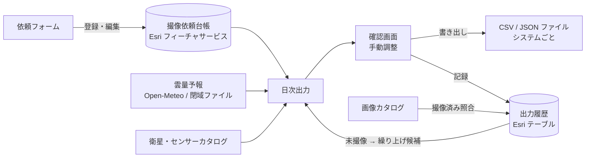
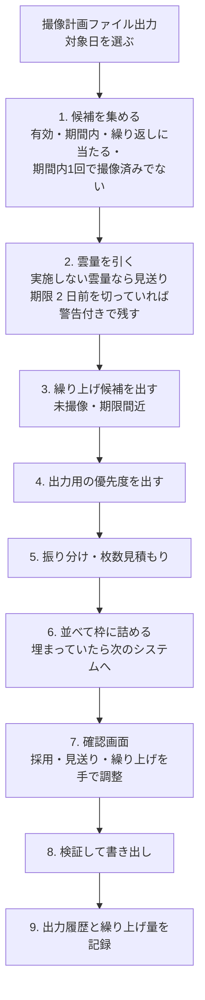

# 撮像依頼台帳と日次出力 設計書

2026-11-07 の相談内容のまとめと、その実装（「撮像依頼」ドック、`core/request/`）。役割の分け方（§13）だけは今後の検討で、まだ実装していない。

## 1. 目的

今の撮像計画は「パスから撮像の可否を見る」ための道具。実際の運用では、各衛星システムに「いつからいつまで・どこを・どのセンサーで撮るか」を入力している。そこで次の 2 つを用意する。

- **撮像依頼台帳**: 定点撮像・臨時撮像の依頼を登録しておく場所
- **日次作業**: 毎日、台帳から依頼を集め、各システムのフォーマットに合わせた CSV / JSON ファイルを作る

できたファイルは、人が各システムに入力する（API での直接送信は将来の課題）。

## 2. 全体構成



モジュールの置き場所（案）

| 置き場所 | 中身 |
|---|---|
| `core/request/model.py` | 依頼のデータ型、属性との読み書き |
| `core/request/store.py` | 台帳・出力履歴の Esri 読み書き（`plan/store.py` と同じ書き方） |
| `core/request/schedule.py` | 対象日に有効かどうか（期間・繰り返し・達成条件） |
| `core/request/route.py` | 条件とシステムの突き合わせ、枚数の見積もり |
| `core/request/weather.py` | 日中の雲量、優先度への反映（`plan/weather.py` を利用） |
| `core/request/quota.py` | 並べ替えと枠詰め |
| `core/request/export.py` | CSV / JSON の組み立て、値の変換 |
| `core/request/schema.py` | JSON Schema の検証（よく使う範囲を自前で実装） |
| `ui/request_dock.py` | 「撮像依頼」ドック（一覧・絞り込み・登録フォーム） |
| `ui/plan_file_dock.py` | 「撮像計画ファイル出力」ドック（日次の計算・確認・書き出し。依頼の登録とは別の人が使うため、撮像依頼ドックから独立） |
| `core/request/simulate.py` / `ui/limit_sim_dialog.py` | 上限シミュレーション（§17） |

## 3. 設定（config.json）

```jsonc
{
  "requestStores": [{
    "label": "撮像依頼",
    "url": "https://…/FeatureServer/0",      // 台帳（ポリゴン）
    "history": "https://…/FeatureServer/1",  // 出力履歴（テーブル）
    "catalog": "画像カタログ",                 // 撮像済み照合に使うカタログ
    "fields": { "priority": "PRIORITY" }     // 属性名を変えるときだけ
  }],
  "requestExports": [{
    "system": "SYS-A",
    "label": "A システム",
    "series": ["XXX"],                       // このシステムで撮れる衛星シリーズ
    "satellites": [],                        // 個別の衛星（任意）
    "kind": "光学",                           // 光学 / SAR / 両方
    "order": 1,                              // 複数のシステムに合うときに試す順番
    "limit": { "count": 20, "scenes": 50 },  // 1 日あたりの上限（片方だけでも可）
    "quota": { "定点": 12, "臨時": 8 },       // 区分ごとの枠（任意）
    "sceneKm": [20, 20],                     // 枚数を見積もるシーンの大きさ（任意）
    "format": "csv",                         // csv / json
    "folder": "D:/requests/SYS-A",
    "fileName": "{system}_{date:%Y%m%d}.csv",
    "encoding": "cp932",                     // cp932 / utf-8 / utf-8-sig
    "timeZone": "Asia/Tokyo",
    "columns": [ /* CSV のとき。§8 */ ],
    "schema": "schemas/sys-b.schema.json",   // JSON のとき。§8
    "priority": { /* 優先度の変換。§5.4 */ },
    "values": { "lookSide": { "右": "R", "左": "L" } }  // 値の読み替え
  }]
}
```

## 4. 依頼台帳

Esri のポリゴンレイヤー（1 依頼 = 1 フィーチャ）。点で指定するときは、フォームで中心と大きさを入れて正方形を作り、`SHAPE_KIND` に「点」と残す。

| 役割 | 既定の属性名 | 中身 |
|---|---|---|
| id | `REQ_ID` | 依頼の ID（UUID） |
| name | `REQ_NAME` | 名称 |
| category | `CATEGORY` | 定点 / 臨時 |
| achieve | `ACHIEVE` | 毎回 / 期間内1回 |
| start / end | `START_AT` / `END_AT` | 期間 |
| repeat | `REPEAT` | 定点の繰り返し: `毎日` / `曜日:月水金` / `間隔:3`（3 日ごと） |
| status | `STATUS` | 有効 / 停止 / 完了 |
| priority | `PRIORITY` | 1〜1000（1 ほど高い） |
| boost | `BOOST` | 繰り上げ量（100 単位。§9） |
| kind | `KIND` | 光学 / SAR / 任意 |
| series | `SERIES` | 衛星シリーズ（カンマ区切り、空なら問わない）。フォームでは撮像計画と同じ階層選択でシリーズ全体をチェック |
| satellites | `SATELLITES` | 衛星を個別に指定（任意） |
| modes | `SENSOR_MODES` | センサー・モード（カタログから選択） |
| offNadir | `OFF_NADIR_MIN` / `OFF_NADIR_MAX` | オフナディア角の範囲 |
| incidence | `INCIDENCE_MIN` / `INCIDENCE_MAX` | 入射角の範囲 |
| lookSide | `LOOK_SIDE` | 右 / 左 / 任意 |
| orbitDir | `ORBIT_DIR` | 昇交 / 降交 / 任意 |
| resolution | `RESOLUTION_MAX` | これより細かい分解能（m） |
| timeOfDay | `TIME_OF_DAY` | 昼 / 夜 / 任意（主に SAR） |
| cloudMax | `CLOUD_NO_GO` | この雲量（%）以上なら実施しない（光学） |
| systems | `SYSTEMS` | 優先するシステムの順番（任意） |
| shapeKind | `SHAPE_KIND` | 点 / 範囲 |
| requester / note | `REQUESTER` / `NOTE` | 依頼者・メモ |
| created / updated | `CREATED_AT` / `UPDATED_AT` | 登録・更新日時 |

台帳・出力履歴とも、`CREATED_DATE`・`CREATED_USER`・`UPDATED_DATE`・`UPDATED_USER` の属性があれば、追加・更新のたびに日時と書き込んだ人（環境変数 `USERNAME`）も入る（設定ファイルの `editTracking`、README の「作成者・更新者の記録」）。

条件の項目は、空なら「問わない」として扱う。

## 5. 優先度

### 5.1 台帳の値
1〜1000 の整数で持ち、1 ほど優先度が高い。

### 5.2 入力
フォームでは 5 段階から選び、選んだ段階の代表値を保存する。「詳細」ボタンを押すと 1〜1000 を直接入れられる（全員が使える）。

| 段階 | 帯 | 代表値 |
|---|---|---|
| 最優先 | 1〜200 | 100 |
| 高 | 201〜400 | 300 |
| 中 | 401〜600 | 500 |
| 低 | 601〜800 | 700 |
| 最低 | 801〜1000 | 900 |

一覧では「高（342）」のように段階と数値を並べて表示する。

### 5.3 出力用の優先度
1. `p = PRIORITY − BOOST`（繰り上げ。§9）
2. 光学で予報が取れたときだけ、1 の位を雲量の段階で上書きする: `p = floor(p / 10) × 10 + 雲量の段階`
3. 1〜1000 に収める

SAR の依頼と予報が取れなかった依頼は、2 を飛ばす。

### 5.4 システムごとの変換（`priority`）
```jsonc
// 対応表: 数値の帯で引く
{ "table": [ { "max": 200, "value": "High" }, { "max": 600, "value": "Middle" }, { "max": 1000, "value": "Low" } ] }
// 線形: 1〜1000 を出力側の範囲に割り当てる
{ "linear": { "min": 0, "max": 99, "higherIsLarger": true }, "format": "%02d" }
```
どちらも最後に `format`（0 埋めの桁数、小数の桁数）をかけられる。

## 6. 気象（光学のみ）

- **予報の取得元**: 今の `cloudForecast`（Open-Meteo 形式の API）。閉域網では、別途検討中の「日次の雲量予報 GeoTIFF をフォルダから読む」方式に差し替える。0.25° の格子と時刻の補間は今の `plan/weather.py` を使う。
- **見る時間帯**: 対象日の日中。範囲の地方時（経度 ÷ 15 で求める地方太陽時）の 9〜15 時。設定で変えられる。パスの時刻は使わない（コンステレーションのように再訪頻度が高い衛星では、時刻ごとに見ても信頼性が上がらないため）。
- **見る場所**: ポリゴンの中の格子点すべての平均。点の依頼は 1 か所。
- **雲量の段階**: `min(9, floor(雲量% / 10))`。0〜9% → 0、…、90% 以上 → 9。
- **実施しない雲量**: 雲量が `CLOUD_NO_GO` 以上なら、その日は出さない（見送り、理由「雲量」）。ただし「期間内1回」の依頼で期限まで 2 日を切っていれば、警告を付けて出す。
- **予報が取れないとき**: 優先度は台帳の値のまま出し、警告「予報なし」を付ける。
- **出力項目**: `cloudForecast`（%）と `weatherFlag`（OK / 雲多 / 予報なし）。

## 7. 日次ワークフロー



1. **候補を集める**: `STATUS = 有効`、対象日が期間内、定点なら繰り返しの決まりに当たる日。「期間内1回」の依頼は、すでに撮像済みなら外す。
2. **雲量**: §6。
3. **繰り上げ候補**: §9。確認画面ではチェックが入った状態で並べ、確定するまでは適用しない（並べ替えにはチェックどおり反映して見せる）。
4. **出力用の優先度**: §5.3。
5. **振り分け**: 依頼の条件（種別、シリーズ、衛星、モード、角度、観測方向、軌道方向、分解能、時間帯）と、システムの `series` / `satellites` / `kind` が重なるシステムを候補にする。試す順番は依頼の `SYSTEMS`、無ければ設定の `order`。どのシステムにも合わなければ見送り（理由「該当システムなし」）。
   **枚数の見積もり**: 点は 1 枚。範囲は、今の撮像計画の範囲分割を使ってシーン数を出す。シーンの大きさは、依頼でモードを特定していればそのモードの幅と長さ、そうでなければシステムの `sceneKm`。
6. **並べ替えと枠詰め**: 出力用の優先度が小さい順、同じなら期限が近い順、次に登録が古い順。上から順に、システムの `limit`（件数・枚数）と区分ごとの `quota` を満たし、かつ衛星（モード）の `maxPerDay` に空きがある間だけ採用する。
   - **衛星を指定している依頼**: 指定した衛星（複数なら書いた順）に先にはめる。空きが無ければ、そのシステムでは見送り。
   - **衛星を指定していない依頼**: 条件に合い、空きのある衛星のうち、分解能が細かいものからはめる。同じ分解能なら空きが多いほう。
   - 割り当てた衛星・モードは出力項目 `satellite` / `mode` として出せる。
   - システムで満たせなければ次のシステムを試し、どこにも入らなければ見送り（理由「枠超過」）。
7. **確認画面**: システムごとに採用と見送りの一覧を出す。採用・見送りの切り替え、順番の入れ替え、繰り上げの取り消しができる。手で変えたら枠の残りを計算し直して表示する。
8. **書き出し**: §8 の形式で、システムごとに 1 ファイル。JSON はスキーマで検証し、合わなければそのシステムは書き出さずにエラーを表示する。同名のファイルがあれば確認する。
9. **記録**: 出力履歴テーブルに、採用・見送りの全件を書く。確定した繰り上げを台帳の `BOOST` に書く。
   - ファイルを書けなかったシステム（スキーマ不一致・書き込みエラー）の依頼は、採用ではなく「見送り（書き出し失敗: 理由）」として記録する。照合も完了もされず、繰り上げと未撮像の確認済みは翌日に残す（#68）。
   - 同じ対象日の出力履歴（まだ判定していない行）が既にあれば、「置き換えて書き出し」（前回の行を消して入れ直す、既定）か「追加して書き出し」かを確認する。保存の一部が失敗したら件数（n/m 件）と理由を出すので、もう一度「書き出し」で置き換えてやり直せる（#71）。

毎回、その日に有効な依頼を全件出す（差分は出さない）。見送った「期間内1回」の依頼は台帳に残るので、翌日の候補にまた入る。

## 8. 出力形式

### 8.1 CSV（キーの指定）
```jsonc
"columns": [
  { "key": "REQUEST_ID", "source": "id" },
  { "key": "START",      "source": "start", "format": "%Y-%m-%dT%H:%M:%S" },
  { "key": "AOI",        "source": "geometry", "geometry": "wkt" },
  { "key": "PRIORITY",   "source": "priority" },
  { "key": "SIDE",       "source": "lookSide", "map": { "右": "R", "左": "L", "任意": "" } },
  { "key": "FIXED",      "value": "1" }          // 固定値
]
```
- 列の順番は `columns` の並び順。ヘッダー行の有無も設定できる。
- `allowed` に値の一覧を書けば、それ以外の値が出たときに警告する。

### 8.2 JSON（JSON Schema で指定）
システムが求める JSON Schema に `x-source` などの注記を足したファイルを置く。

```jsonc
{
  "type": "object",
  "required": ["date", "requests"],
  "properties": {
    "date":     { "type": "string", "format": "date", "x-source": "runDate" },
    "requests": {
      "type": "array", "x-source": "requests",
      "items": {
        "type": "object",
        "required": ["id", "aoi", "priority"],
        "properties": {
          "id":       { "type": "string",  "x-source": "id" },
          "aoi":      { "type": "object",  "x-source": "geometry", "x-geometry": "geojson" },
          "priority": { "type": "string",  "enum": ["High", "Middle", "Low"], "x-source": "priority" },
          "from":     { "type": "string",  "format": "date-time", "x-source": "start" }
        }
      }
    }
  }
}
```
- `x-source`: 入れる項目。`requests` の付いた配列が依頼の一覧になり、`items` の中の `x-source` は依頼 1 件ごとの項目を指す。
- `const` が書かれた項目は、その値をそのまま出す（`x-source` 不要）。
- `x-format` / `x-map` / `x-geometry` / `x-digits`: CSV の `format` / `map` / `geometry` と同じ働き。
- 検証で扱う範囲: `type`、`required`、`enum`、`const`、`pattern`、`minimum` / `maximum`、`minLength` / `maxLength`、`minItems` / `maxItems`、`format`（date / date-time）、`items`、`properties`、`additionalProperties`。外部ライブラリの jsonschema を使う場合は、方針どおり Windows 版の zip にだけ同梱する。

### 8.3 使える項目（`source` / `x-source`）
`id`, `name`, `category`, `satellite`（割り当てた衛星）, `mode`（割り当てたモード）, `achieve`, `start`, `end`, `priority`（§5.4 で変換した値）, `priorityRaw`（出力用の優先度 1〜1000）, `priorityBase`（台帳の値）, `kind`, `series`, `satellites`, `modes`, `offNadirMin`, `offNadirMax`, `incidenceMin`, `incidenceMax`, `lookSide`, `orbitDir`, `resolution`, `timeOfDay`, `cloudMax`, `cloudForecast`, `weatherFlag`, `scenes`, `geometry`, `centerLat`, `centerLon`, `bboxWest` / `bboxSouth` / `bboxEast` / `bboxNorth`, `requester`, `note`, `system`, `runDate`, `count`（そのファイルの依頼件数）, `warnings`

### 8.4 座標の書き方（`geometry` / `x-geometry`）
`wkt` / `geojson` / `bbox`（西,南,東,北）/ `center`（緯度,経度）/ `centerRadius` / `vertices`（緯度経度を並べた文字列）。小数の桁数も指定できる。

### 8.5 日時
- **対象日**は JST で区切る（00:00〜24:00 JST）。
- **出力のタイムゾーン**はシステムごとに `timeZone` で指定する（`"UTC"` / `"Asia/Tokyo"` / `"+09:00"` など。既存の timeZone 設定と同じ書き方）。
- **書式**は既定が ISO 8601。システム全体の `dateFormat`、または列・項目ごとの `format` / `x-format` で変えられる。

| 指定 | 例（2026-11-08 09:00 JST、出力 UTC） |
|---|---|
| `iso`（既定） | `2026-11-08T00:00:00Z`（JST 出力なら `2026-11-08T09:00:00+09:00`） |
| `iso-date` | `2026-11-08` |
| `unix` | `1794096000`（秒） |
| `unixms` | `1794096000000`（ミリ秒） |
| strftime 形式 | `%Y%m%d` → `20261108`、`%Y/%m/%d %H:%M` → `2026/11/08 00:00` |

unix / unixms はタイムゾーンに関係なく同じ値になる。

## 9. 撮像済みの判定と繰り上げ

- **出力履歴**（Esri テーブル）: `RUN_ID`, `RUN_DATE`, `REQ_ID`, `SYSTEM`, `PRIORITY_OUT`, `CLOUD`, `SCENES`, `RESULT`（採用 / 見送り）, `REASON`, `OUTPUT_FILE`, `CAPTURED`（未判定 / 撮像済み / 未撮像）, `IMAGE_ID`
- **撮像済みの判定**: 採用した依頼について、画像カタログで「範囲と重なり、出力日以降に撮られた、条件に合う画像」を探す。見つかれば撮像済み、`miss_after_days` を過ぎても無ければ未撮像（保存した撮像計画の照合と同じ仕組み）。
- **「期間内1回」の依頼**: 撮像済みになったら台帳の `STATUS` を「完了」にする。
- **繰り上げ候補**: 未撮像になった依頼と、期限まで 2 日を切った「期間内1回」の依頼。
- **繰り上げの幅**: 1 回につき `BOOST` を 100 増やす。`PRIORITY − BOOST` が最優先の帯（200 以下）に入ったら、それ以上は増やさない。例: 742 → 642 → … → 142 で止まる。下 2 桁が残るので、帯の中での順番は崩れない。
- **撮像済みになったら**: `BOOST` を 0 に戻す。
- **衛星の一致**（2026-11-07 追記）: 衛星かシリーズを指定した依頼は、渡した衛星・指定の衛星・シリーズ（衛星名の対応表 `satelliteAliases` の別名を含む）の画像だけを撮像済みとする。ほかの衛星の画像が範囲にあっても数えない。指定のない依頼はどの衛星の画像でもよく、渡した衛星の画像を優先して `IMAGE_ID` にする。
- **持ち越し**（2026-11-07 追記）: 未撮像の依頼は次回の計算の候補に入れる。曜日・間隔の定点でその日が繰り返しの日でなくても、状態が有効で期間内なら候補にし、「未撮像の持ち越し」と警告を付ける。書き出すと `BOOST_DONE` が 1 になり、持ち越しも繰り上げもそれきり。
- **計画と実績の照合**（2026-11-07 追記）: 「撮像計画ファイル出力」ドックの「照合…」で開く。対象日の範囲の採用の依頼を一覧にし（対象日・システム・衛星・依頼・撮像・画像ID・この先）、システムごとに撮像済み・未撮像・未判定と撮像率（判定済みのうち撮像済みの割合）を出す。「照合」で未判定の依頼をカタログと照合して保存する。「撮像済みにする」「未撮像にする」で手で直せる。撮像済みにすると台帳の `BOOST` は 0・期間内1回は完了に、完了の依頼を未撮像に戻すと有効に戻り、`BOOST_DONE` も 0 に戻るので次回また繰り上げの候補になる。

## 10. 警告と見送りの理由

| 種類 | 内容 |
|---|---|
| 見送り | 雲量（実施しない雲量以上）、枠超過、該当システムなし、手動で見送り |
| 警告 | 予報なし、期限間近で雲量超過のまま出力、値の読み替え表に無い値、範囲がシステムの制約外（頂点数など） |
| エラー | JSON Schema に合わない（そのシステムは書き出さない）、出力フォルダに書けない |

## 11. 実装の段階（2026-11-07 にすべて実装）

1. 台帳と登録フォーム（Esri 読み書き、「撮像依頼」ドック、範囲を描くマップツール、優先度の 5 段階と「詳細」）
2. 候補集め・振り分け・枚数見積もり・枠詰め・確認画面（気象なし）
3. 書き出し（CSV のキー指定、JSON Schema と検証、変換）
4. 気象（日中の雲量、1 の位への反映、実施しない雲量）
5. 出力履歴・撮像済みの判定・繰り上げ

## 12. 決まったこと（2026-11-07 追記）

1. 衛星の `maxPerDay`: 衛星を指定した依頼はその衛星に先にはめる。指定が無い依頼は空きのある衛星へ、分解能の細かいほうを優先（§7 の 6）。
2. 枚数の見積もり: モードを特定していない依頼はシステムの `sceneKm` を使う。
3. 繰り返し: 毎日・曜日・間隔の 3 つで足りる。祝日は考えない。
4. 対象日は JST で区切る。出力は UTC / JST をシステムごとに指定でき、書式は ISO を基準に unix や strftime 形式も使える（§8.5）。
5. 役割の分け方: 今後検討（tsudo、2026-11-07）。§13 は案のまま、実装していない。
7. 定点の依頼はレイヤーから取り込み・レイヤーへ書き出しできること（§15）。
8. 衛星とシステムの対応: 衛星カタログに `system` 列（`fields.system`）があればそれを優先し、無ければ `requestExports` の `series` / `satellites` で判定する。
6. 各システムのフォーマット: tsudo さん側で作る。参考のサンプルを `request-samples/` に置いた（§14）。

## 13. 役割の分け方（案・未実装）

### 13.1 想定する役割

| 役割 | 主に使う機能 |
|---|---|
| 撮像計画者 | 撮像計画、保存した撮像計画、衛星パス、移動目標、撮像依頼の登録・編集 |
| 撮像オーダー者 | 撮像依頼の閲覧、日次出力（確認画面・書き出し・繰り上げの確定）、出力履歴 |
| 画像分析者 | 画像カタログ、新着通知、画像補正、観測記録、分類体系、AI 結果・AI 学習・物体検出 |

座標・地名へ移動、ベースマップ、設定などは全員が使う共通機能とする。

### 13.2 おすすめ: プラグインは 1 つのまま、設定で機能を絞る

プラグインを役割ごとに分けると、共通部分（カタログ、衛星計算、Esri 接続、タイムゾーンなど）の修正を毎回すべてに入れることになり、保守がつらくなる。プラグインは 1 つにして、次の 3 段で分ける。

1. **設定ファイルの `features`**: 使う機能を役割の名前、または機能ごとに指定する。

   ```jsonc
   "features": {
     "roles": ["撮像オーダー者"],          // 役割の名前で有効にする
     "enable": ["satellitePass"],          // 追加で有効にする機能
     "disable": ["requests.edit"]          // 役割にあっても外す機能
   }
   ```
   無効な機能はドック・メニュー・ツールバーに出さず、`plugin.api` からも呼べないようにする。`features` が無ければ今までどおり全部使える。

2. **役割ごとの zip**: `build_zip.py --config 撮像オーダー者.json --lock-config` で、役割ごとの設定を同梱して固定した zip を配る（既存の仕組みのまま）。利用者が別の設定ファイルを読み込んで機能を広げることはできない。

3. **本当の権限は Esri 側**: プラグインで機能を隠すのは「画面を整理する」ためで、権限の代わりにはならない。台帳は撮像計画者だけが編集でき、出力履歴は撮像オーダー者だけが書ける、というように、フィーチャサービスの共有や編集の権限で守る。プラグインは書き込みが拒否されたときに分かりやすく伝える。

### 13.3 追加の案: ポータルのグループから役割を決める

設定に `roleGroups`（役割の名前 → ArcGIS ポータルのグループ ID）を書いておけば、サインインした人の所属グループから役割を自動で決められる。同じ zip を全員に配っても、所属だけで機能が変わる。人の異動はポータルのグループを直すだけで済み、Esri 側の権限ともずれにくい。ポータルに入れないときは、`features.roles` に書いた役割を使う。

### 13.4 機能の名前（案）
`catalog`, `notices`, `enhance`, `plan`, `savedPlans`, `satellitePass`, `movingTargets`, `observations`, `taxonomy`, `aiResults`, `aiTrain`, `detect`, `requests.view`, `requests.edit`, `requests.export`

## 14. サンプル

[request-samples/](request-samples/) に置いた。

| ファイル | 中身 |
|---|---|
| `config.sample.jsonc` | `requestStores`、`requestExports` 3 システム分 |
| `sys-a.csv.example` | A システム（CSV、CP932、JST、優先度 High/Middle/Low）の出力例 |
| `sys-b.csv.example` | B システム（CSV、UTF-8、UTC、unix 時刻、優先度 00〜99 の 2 桁）の出力例 |
| `schemas/sys-c.schema.json` | C システム（JSON）の JSON Schema に `x-source` を書き添えた例 |
| `sys-c.json.example` | C システムの出力例 |

## 15. レイヤーからの取り込み・レイヤーへの書き出し

- 「レイヤーから取り込み…」: 任意のレイヤー（ポリゴン・点・線）と、名称に使う属性を選ぶ。取り込むのは地物の範囲と名称だけで、期間・優先度・衛星などの残りの項目は依頼の入力画面で全件まとめて指定する（tsudo, 2026-11-07）。名称の属性が空なら「レイヤー名 連番」。点は一辺（既定 10 km）の正方形、線は外接矩形にする。選択中の地物だけにもできる。
- 「台帳と同じ属性も読む」を選んだときだけ、属性から全項目を読む（「レイヤーへ書き出し」したものを戻すとき）。属性は、台帳の属性名（`REQ_ID`・`REQ_NAME`・`START_AT` …）、項目名（`id`・`name`・`start` …）、見出し（依頼ID・名称・区分・達成条件・開始・終了・繰り返し・状態・優先度・繰り上げ量・種別・衛星シリーズ・衛星・センサーモード・オフナディア角下限・オフナディア角上限・入射角下限・入射角上限・観測方向・軌道方向・分解能・時間帯・実施しない雲量・優先システム・範囲の種類・依頼者・メモ）のどれかで対応づける（大文字・小文字、空白・`_`・`・` は区別しない）。
- 無い項目は定点の既定値（区分 定点・達成条件 毎回・繰り返し 毎日・状態 有効・優先度 500）。優先度は数値か段階名（最優先・高・中・低・最低）。開始・終了は日付（`2026-11-08`、日本時間の日）か日時。期間か範囲が無い地物は取り込まない。
- 依頼ID が台帳にある依頼と同じなら上書き、無ければ新規。
- 「レイヤーへ書き出し」: 一覧に出ている依頼（区分で「定点」を選べば定点だけ）を一時レイヤー（WGS 84 のポリゴン、台帳と同じ属性名、開始・終了は日本時間の日付）として追加する。そのまま編集して取り込み直せる。

## 16. 実装メモ

- 出力履歴テーブルの属性: `RUN_ID`・`RUN_DATE`・`TARGET_DAY`・`REQ_ID`・`SYSTEM`・`SATELLITE`・`PRIORITY_OUT`・`CLOUD`・`SCENES`・`RESULT`・`REASON`・`FILE`・`CAPTURED`・`IMAGE_ID`・`BOOST_DONE`（名前は `historyFields` で変えられる）。
- 出力履歴は全件を読まず、用途の条件で読む（#69）: 「計算」と上限シミュレーションは判定待ち（採用・未判定）と繰り上げ待ち（未撮像・`BOOST_DONE` 0）の行だけ、「照合…」はそれに加えて表示する対象日の範囲。Esri から読む件数が上限を超えたら、一部だけを使わずに読み込みを止めて理由を出す（ページは OBJECTID 順）。
- 撮像済みの判定は「撮像計画ファイル出力」ドックの「計算」のたびに行う。対象日の範囲（日本時間の 1 日）に、依頼の範囲と重なる画像がカタログにあれば撮像済み。`missAfterDays`（既定 3 日）を過ぎても無ければ未撮像。
  - 台帳に依頼が無い（削除された）行や範囲の無い依頼の行は問い合わせず、未判定のまま「台帳に依頼なし」と出す（その日のどこかの画像で撮像済みにしない、#77）。
  - 衛星を指定した依頼は、衛星名が同じ（`satelliteAliases` の別名を含む）か、書いた名前で始まる語の並び（`WorldView-3` → `WorldView-3 PAN`、系列 `OPT-X` → `OPT-X 2`）の画像だけを数える。型番が続く別の衛星（`KOMPSAT-3` と `KOMPSAT-3A`）や短い名前（`ALOS` と `ALOS-2`）は数えない（#78）。
  - 撮像日時が文字列の画像カタログは、カタログの値と同じ書き方（`T` か空白、`timeZone` か値に付いたオフセットの時刻）で範囲を作り、終わりは「翌日 0 時より前」で比べる（#79）。
- 衛星の `maxPerDay` は 1 日に受ける依頼の件数として数える。
- 「書き出し」はその時点の計画の写しからファイル・出力履歴・繰り上げを作る。作成中は表のチェック（採用・繰り上げ）と上へ・下へ・戻すを受け付けない（ファイルと履歴が食い違わないように、#84）。
- 光学かどうか: 種別が光学の依頼、または種別「任意」で条件に合う衛星がすべて光学の依頼に、気象を効かせる。
- 出力の `start` / `end` はその日の撮像の窓（毎回: その日の 0 時〜24 時、期間内1回: その日の 0 時〜依頼の終わり）。依頼そのものの期間は `periodStart` / `periodEnd`。

## 17. 上限シミュレーション（2026-11-07 追加）

「撮像計画ファイル出力」ドックの「上限シミュレーション…」。日ごとの上限や使うシステムを変えた場合に、何件が溢れて期限切れになるかを、設定に入れる前に試算する。

- **入力**: 開始日（日本時間、既定はドックの対象日）、日数（1〜60、既定 14）、雲量予報を使うか、システムごとの「使う」・件数上限・枚数上限・定点枠・臨時枠（空欄は制限なし）。
- **計算**: 台帳と出力履歴を読むだけで、書き込みはしない。試算そのものもタスクで走らせ、計算中も QGIS は止まらない（状態バーから取り消せる、#83）。開始日から 1 日ずつ、§7 の候補集め・雲量・繰り上げ・並べ替え・枠詰め（埋まっていたら次のシステム）をそのまま使う。
  - 繰り上げ候補（未撮像・期限まで 2 日以内の期間内1回）は、確認画面の既定どおりチェックありとして 100 ずつ繰り上げる。未撮像は出力履歴のものを初日だけ使う。
  - 採用した依頼は撮像できたものとして扱う（繰り上げを 0 に戻し、期間内1回は完了）。
  - 雲量は予報のある日だけ。予報のない日は見送らない（晴れとして計算）。
- **結果**: 同じ期間を設定の値でも計算し、「合計」で並べて差を出す（採用・枠超過で見送り・次のシステムへ回送・雲量で見送り・該当システムなし・繰り上げ・欠測（毎回）・期限切れ（期間内1回）・最終日の持ち越し）。「日ごと」に日別の件数とシステムごとの使用量（件数/上限・枚数/上限）、「期限切れ」に最終日までに一度も採用されなかった期間内1回の依頼と最終日の理由。
- **回送**: 依頼が最初に試すシステム（条件に合う衛星があるもののうち、依頼の優先システム → 設定の順で最初）以外で採用された件数。
- 試算した値を使うには、設定ファイル（`requestExports` の `limit` / `quota`）を書き換える。
